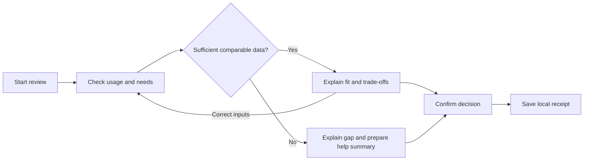

# PlanFit Navigator Core

> **Repository preparation — 14 October 2026:** This is an individual candidate proposal dated 23 September 2026, not a recorded team decision. Current [V3 requirements](../作业要求.md) specify **OpenCode.ai + SAP APIs**. Build Apps/AppGyver/Build Code sections and their effort estimates below are retained as historical planning; API fit and revised implementation effort require validation. Local-only A1/A2 evidence is identified by source filename and is not bundled.

> **Course-source update — 6 October 2026:** The current [A3 V3 requirements](../作业要求.md) now specify **OpenCode.ai + SAP APIs** and an exported ZIP. The [API Pool v3](<../resources/api/SAP API Pool v3.xlsx>) is available locally. The Build Apps/AppGyver/Build Code implementation and platform conclusions below are a **23 September research snapshot, superseded as current course instructions**. Preserve the business proposal and historical citations; API fit, revised effort, actual access, independent package execution and the team's final choice have not been verified. This update does not select, redevelop or validate PlanFit.

## An A3 candidate for explainable mobile-plan decisions

**Candidate ID:** FRANCIS-STRATEGIC-PLANFIT  
**Organisation / domain:** Spark New Zealand Limited / Strategic–Competitive  
**Prepared for:** The group's later comparison of four A2-derived candidates  
**Evidence checked:** 23 September 2026  
**Status:** AI-assisted planning proposal. Unranked and not selected by the group. No app development, tenant setup, user testing or submission has taken place.

PlanFit helps a customer answer a practical question: **“Given my usage, costs and preferences, should I change my plan or keep it?”** The proposed A3 app takes a small set of inputs, compares a labelled demonstration catalogue, explains a rule-based conclusion, and saves the customer's explicit decision. A keep-current result receives the same attention as a change recommendation.

The recommended classroom scope is a responsive, four-screen web prototype with a deterministic calculation, correction and exception paths, and a local decision record. It has no dependency on live Spark systems. Its value is to make the A1/A2 decision-support mechanism observable and testable. A future Spark deployment would require separate evidence about internal processes, commercial suitability, integration and retention effects.

| At a glance | Proposed position |
|---|---|
| Primary user | An individual consumer reviewing a Spark-branded mobile plan; classmates act as consumer proxies in classroom tests |
| Core working feature | Validated usage/preferences → comparable costs and allowances → explained fit conclusion → explicit decision and saved receipt |
| Distinctive feature | Explain why a cheaper option may be unsuitable, and make keeping the current plan an explicit outcome |
| Prototype data | Bundled fictional plans, synthetic usage and simulated eligibility; no account credentials or customer records |
| Implementation | Course-confirmed SAP environment: conditional Build Apps visual logic or Build Code/SAPUI5 route |
| Planning estimate | **54–83 total person-hours**, including approximately 20% contingency; assumptions and breakdown in §8 |
| Main uncertainty | Course platform/package contract and team capability; enterprise impact remains unproven |

## 1. Business rationale and evidence boundaries

The A1/A2 chain identifies a gap in the **publicly documented** consumer plan-review journey: information and plan options do not necessarily become a timely, transparent fit conclusion. This is an analytical finding about the documented path, not proof that Spark's internal process lacks such support. The original boundary runs from recognising a possible mismatch to having enough information to stay, change, defer, decline or consider leaving (Lee, 2026a, §§2.3–4.3).

Three sources make this a defensible candidate for investigation:

| Evidence | What it supports | What it does not establish |
|---|---|---|
| **Verified public context:** Spark group's connection share moved from 42% in June 2022 to 38% in June 2025 (Commerce Commission, 2026, p. 216). | A competitive reason to investigate consumer value and retention. | That plan-review friction caused the change; group share is broader than the prototype's consumer scope. |
| **Verified public benchmark:** the Commission's guidance calls for understandable usage/spend information, longer history and useful comparison information (Commerce Commission, 2025, pp. 7–9). | Display costs, allowances, time period and trade-offs together. | Spark non-compliance or a claim that this prototype fulfils the complete guidelines. |
| **Authentic interview evidence:** Ryan Li's readiness rating increased from 3/5 to 4/5 after an explained output. He valued visible costs, headroom, uncertainty and a no-change option (R. Li, personal communication, August 21, 2026, S4–S9). | An exploratory design lead for the H1M decision-readiness mechanism. | Population-level preference, actual Spark internal practice, or reduced churn. The interview had one consumer proxy and a fixed A→B order. |

Spark's current public help page also describes plan-change timing, potential contract fees and linked-plan eligibility. These are reasons to expose uncertainty and restrict the classroom calculation to a simple case; they are not rules that the prototype may invent on Spark's behalf (Spark New Zealand Limited, n.d.).

**Expected business value — an inference to test.** A customer may spend less effort interpreting plans and make a more informed choice. Spark may gain trust, more consistent explanations and clearer reasons for customer decisions. Savings for a customer may reduce revenue, so a production case must evaluate contribution margin and retention together. A3 can test understandable decisions and reliable workflow behaviour; it cannot demonstrate a positive return on investment.

The latest A2-D1 remains deliberately conditional: its assumed enterprise case has a simplified three-year NPV of **−NZ$1.114m**, with only **NZ$120k Phase 0** proposed initially; the **NZ$280k Phase 1** release is separate. Release into **Phase 2 design/prototyping at M2** requires an updated Finance-accepted case meeting NPV ≥ 0 and BCR ≥ 1, alongside the data, power and control conditions. These are proposal assumptions and decision rules, not Spark approvals or A3 development costs (Lee, 2026a, §§1, 6 and 10; Lee, 2026b, §4).

## 2. Scope: a small but complete decision journey

The A1/A2 business scope covers consumer pay-monthly and prepaid plans. **This A3 slice covers fictional, individual, open-term pay-monthly plans with fixed monthly data allowances.** This narrows the prototype without changing the upstream problem.

The primary user has noticed a bill or usage mismatch and wants a clear comparison. A secondary user is a demonstrator or reviewer inspecting the saved calculation. An adviser-facing view is represented by a readable help summary; there is no staffed service or actual message transmission.

### Four proposed screens

| Screen | Customer action and visible result | Why it belongs |
|---|---|---|
| **1. Start a review** | Select a fictional current plan and confirm the supported plan type. Read a persistent “Course prototype — fictional plans; no account changes” notice. | Establishes context and avoids implying a connection to MySpark. |
| **2. Check usage and needs** | Inspect three labelled months of synthetic usage, recurring costs and included allowances; set a maximum monthly budget, expected future usage and desired spare data. Confirm whether the period is typical. Correct inputs in place. | Addresses the interview's concerns about add-ons and atypical usage. |
| **3. Compare and understand** | See the current plan and two alternatives in common units. Read a conclusion, the calculation behind it, exclusions and uncertainty. Edit inputs, select a decision, or prepare a help summary. | Makes the provisional PlanFit mechanism directly observable. |
| **4. Confirm and retain the decision** | Review the choice and latest calculation, then save a local receipt. Receipt states the decision, reasons, assumptions and whether any further action would be needed. | Completes the workflow and separates a decision from fulfilment. |

The decision choices are **keep current, choose a change, defer, decline the suggestion, or consider leaving the provider**. The final choice records stated intent only; it does not cancel service or count as churn. A separate **Exit review** action saves a no-decision state when storage succeeds. Abrupt tab/browser closure cannot reliably save an exit event: any retained unfinished review remains **incomplete / no decision recorded**, not confirmed abandonment or provider churn.

A simulated change can be confirmed only for a currently qualifying alternative. Choosing to keep the current plan remains possible when no fit conclusion is available, but the receipt labels it as the customer's choice, without claiming suitability or recommendation acceptance.

**Required prototype behaviour:** calculation, input validation, an explainable change/keep/help result, all decision routes, correction, revalidation at confirmation, receipt persistence and reset. A small record viewer supports inspection; an executive analytics dashboard is unnecessary for this scope.

**Optional after the core works:** a matched raw-versus-explained view for exploratory H1M testing; a separate simulated fulfilment state; or a small event-count summary. Each has a separate effort estimate in §8.

**Outside this slice:** prepaid/28-day price conversion, rollover and speed-throttling models, shared/family bundles, roaming, device finance, contractual exit fees, live MySpark login, CRM/billing integration, real transactions, loyalty incentives, proactive targeting, whole-market comparison and an AI chatbot. Unsupported plan features route to an explanation/help outcome. The customer sees “within this demo catalogue”, not a market-wide “best plan” claim.

## 3. A transparent rule that can actually be implemented

All rules below are **proposed classroom assumptions**: `[CONSULTING ASSUMPTION - VALIDATION REQUIRED]`. They are not Spark's suitability policy. The app calculates the cheapest supported option that meets the stated constraints; it does not optimise acceptance, upsell or profit.

### Input and decision contract

1. Require complete, non-negative usage values, a current plan, a budget, an expected usage value and an explicitly confirmed spare-data preference. Empty fields are unknown, not zero.
2. Work in NZD per calendar month and GB. Compare the same included services. The fixture assumes equivalent calls/texts. Unknown mandatory costs, non-comparable billing periods or unsupported features prevent a fit recommendation.
3. Define the demand reference `D = max(highest observed monthly usage, expected future monthly usage)`. Define the desired buffer `B` as the user's stated spare-data preference. A default of 1 GB may be displayed, but must be explicitly confirmed or changed; it is not a validated safety threshold.
4. Calculate each plan's comparable recurring total `T = base fee + required recurring add-ons − applicable recurring discounts`. All components must be known. The example catalogue has no add-ons or discounts. Expose excluded one-off costs; any unresolved applicable fee sends the case to help.
5. Known ineligible alternatives are excluded. Unknown eligibility/retainability or required cost for any remaining supported plan blocks the overall ranking and produces an uncertainty/help result; the app must not silently discard an unknown alternative. An option qualifies only if its **simulated** eligibility/retainability is confirmed, its conditions are supported, `allowance ≥ D + B`, and `T ≤ budget`. Atypical history or unknown future needs also generates uncertainty/help.
6. Rank qualifying options by total recurring cost. Break a cost tie in favour of the current plan, then by a fixed plan ID. If the current plan wins, explain why keeping it makes sense. If none qualifies, explain the limiting conditions and offer help/defer. Keep the current plan visible even when it fails the selected constraints, without recommending it as suitable.
7. Show `monthly saving = current comparable total − proposed total` and `headroom = allowance − D`, together with the usage period, buffer, price assumptions and exclusions. Use deterministic explanation templates tied to the actual checks.
8. On confirmation, check the input, catalogue and simulated eligibility versions again. If something changed, require a new calculation and confirmation. Only then save the decision. This is not fulfilment.

Money should use integer cents internally; comparisons use unrounded values, and presentation uses two decimal places where needed. No external model, API key or paid inference is required by the proposed runtime.

### Fictional catalogue and repeatable examples

The three plans below reuse the explicitly fictional A1-D2 stimulus; they are **not current Spark offers**. The first usage case is newly proposed synthetic data. The second preserves the original interview stimulus for a boundary test (Lee, 2026c, §4.1 and Appendix D).

| Fictional plan | Recurring price | Monthly allowance | Demonstration conditions |
|---|---:|---:|---|
| Current C | NZ$60 | 12 GB | Retainable, open term, no add-ons |
| Alternative X | NZ$55 | 10 GB | Eligible, open term, no add-ons |
| Alternative Y | NZ$65 | 20 GB | Eligible, open term, no add-ons |

| Case | Inputs | Expected conclusion under these proposed rules |
|---|---|---|
| **A — a justified change** | Usage 5.2/5.8/6.1 GB; expected 6.1 GB; confirmed buffer 1 GB; budget NZ$60; typical history | X qualifies. Saving is NZ$5/month and headroom is 3.9 GB. Show that this conclusion depends on the stated needs and fictional conditions. |
| **B — a justified keep-current result** | Original 7.8/8.4/9.1 GB usage; expected 9.1 GB; buffer 1 GB; budget NZ$60 | X's 0.9 GB headroom misses the chosen buffer. C qualifies; Y exceeds budget. Recommend keeping C. This is a new rule-based interpretation, not a rewrite of Ryan's response. |
| **C — needs exceed the budget** | Case A usage; expected 15 GB; buffer 1 GB; budget NZ$60 | C and X lack allowance; Y exceeds budget. No qualifying option. Explain the conflict without automatically raising the customer's budget. |
| **D — uncertainty** | Run three separate variations of Case A: current C has an unknown required add-on cost; X's eligibility is unknown; or history is marked atypical | Each variation blocks the overall fit conclusion and prepares help. In the X variation, do not recommend C merely because X is unknown. Show the exact gap; do not present an estimated saving as reliable. |

Three months keep the demonstration compact. The Commission's longer-history benchmark is **at least 12 months, where applicable/available**; a real service would need that broader history and seasonality handling. This prototype does not demonstrate regulatory compliance (Commerce Commission, 2025, pp. 7–9).

## 4. Implementation and data plan

### Platform decision remains conditional

On 23 September, the live assignment title and functionality rubric still referred to **SAP Build Code**; the attached V1 specification and newly available **Lab 8 V1, slide 8**, still referred to **AppGyver/Build Apps**. Lab 8 did not resolve the source/package conflict. Use the product and environment confirmed by the course before starting implementation (INFOSYS 704 Teaching Team, 2026a, 2026b).

| Component | If existing Build Apps access is confirmed | If Build Code is confirmed |
|---|---|---|
| Interface | Four pages, reusable controls, page/app variables and navigation | Small SAPUI5/JavaScript web app in Business Application Studio |
| Catalogue and rule | Bundled objects/lists, formula bindings and visual conditions | Bundled JSON and a small deterministic calculation module |
| Record | On-device data entity with explicit read/write failure handling | Browser-local storage behind a small record interface |
| Verification | Fixture-driven preview checks plus an independent run of the package | Calculation tests and browser workflow checks plus an independent source-package run |

This mapping is an engineering proposal, not a tested implementation. Build Apps documents device/browser-local storage; it neither shares records across devices nor proves a production audit trail (SAP, n.d.-d). A production version would need governed catalogue updates, identity, server-side validation, durable records, access control and actual integration.

There is a material lifecycle dependency: SAP describes standalone Build Apps as deprecated from **23 March 2026**, while supporting existing customers through their contracts. The university's entitlement was not verified. SAP also distinguishes lobby **MTAR** exports from Build Code/BAS **source ZIP/TAR** import, and personal BTP trials exclude team development. An AppGyver ZIP, an editable project and a compiled deployment are not interchangeable (SAP, n.d.-a, n.d.-b, n.d.-c, n.d.-e).

**First task after team selection and development authorisation:** confirm the tenant, permitted collaboration, package type, marker's open/run procedure and retention through marking. Then prove a one-input/one-result example can be exported and reopened by another member. Each member must also create one synthetic receipt and reopen it in the same browser to check persistence; records are not expected to transfer with the package. Complete this check before expanding the workflow. Do not plan a last-minute platform migration. Supporting details and official URLs are in the [platform evidence note](../docs/platform-history/A3_Platform_Feasibility_Notes_2026-09-23.md).

### Minimal information model

| Record | Proposed contents | Evidence status |
|---|---|---|
| Plan fixture | Plan ID; monthly cost components; allowance; supported conditions; simulated eligibility; catalogue version | Synthetic, bundled with the app |
| Review | Review ID; usage periods/values; expected usage; buffer; budget; typicality; selected current plan | Synthetic scenario and tester-entered fictional adjustments |
| Output | Output version; qualifying options; selected conclusion; calculations; exclusions; rule/catalogue versions | Calculated from the fixture and declared rules |
| Decision/event | Review/output IDs; event type; time; choice; recommended-choice acceptance flag; storage status | Observed prototype actions only |

Use pseudonymous review IDs. Keep the original interview in the Evidence Pack; do not bundle it, participant names, credentials or browser sessions in an app ZIP. Reopening the package must recreate the catalogue and scenario seeds without depending on the original tester's browser. Records persist only within the demonstrated browser; a fresh browser starts clean. A visible reset restores fixtures for another run.

## 5. Measurement without overstating what the app proves

The 18 September A2-D1 definitions supersede older A1 terminology for downstream design (Lee, 2026a, §3.2; Lee, 2026b, §4).

| Event or measure | Prototype interpretation | Evidence limit |
|---|---|---|
| Review started | Explicitly start a review; allocate one ID before producing an output | Page reload is not another review |
| Output delivered | Calculation is displayed and the corresponding output event is saved | Display is not proof of reading or comprehension |
| Recommendation accepted | Explicitly confirm the currently valid recommendation; recommended keep-current counts only on explicit confirmation | Choosing another option, deferring or declining is a valid decision but not acceptance of that recommendation |
| Review exited / incomplete | Record an explicit Exit review action if saved; otherwise inspect the last saved review state | Browser closure is not a reliably observed exit event; no decision recorded does not reveal the customer's intent |
| Fulfilled | **Not implemented in the core.** An optional simulator must use a separately labelled event | Acceptance never means a real account changed |
| H1M | Exploratory readiness and comprehension after an explained result | Consumer-proxy usability evidence only |
| H1Q | Outside A3 measurement: all qualifying 90-day voluntary churn in an adequately powered, valid pilot | No churn-reduction percentage inferred from demo choices or leaving the review |

For demonstration counts, propose one review-level denominator: corrections create new output versions under the same review ID; repeated rendering does not add another start or delivered review. Final decisions refer to the latest version, and cancelled/superseded decisions remain distinguishable in history. This is an **A3 counting convention to validate**, not an approved Spark event specification.

If the optional summary is built, retain A2's distinctions: `R_d/R_s` is delivery/reach; `R_a/R_e` is explicit acceptance among reviews with suitability-valid treatment recommendations. A comparator choice is counted separately. Show **N/A** for an empty denominator. The A2 60% target and 20% acceptance diagnostic reference are not A3 usability pass marks. In particular, 20% must not become a sales quota or a reason to alter the recommendation rule.

## 6. Design and validation approach

### Design Thinking evidence to produce later

Use the five-stage framework as an iterative method (Dam, n.d.). Begin with the existing interview and public sources; observe a small set of consenting classmates using fictional scenarios. Define the need as **making an informed plan decision while retaining control**. Compare two designs on paper: a comparison table alone and a table with an explained conclusion. Prototype the four-screen flow, test it, record failures and revise it.

All new interviews, observations and results remain **pending**. Do not recruit Spark employees: the course's Week 3 announcement prohibits contacting employees of the selected organisation. Confirm the permitted classroom testing and GenAI scope before using generated material as assessed work. The Week 6 announcement restricts GenAI-written core intellectual content; this document records AI-assisted candidate planning, not a claim of compliance or independent student authorship.

### Usability choices

Use a restrained Spark-oriented colour palette, clear NZD/month and GB labels, generous spacing and the same comparison rows for all plans. On narrow screens use stacked cards with repeated labels; on a laptop keep the plans side by side. Do not rely on colour to distinguish suitable, uncertain and unsuitable states. Keep rule IDs and test controls in the reviewer view rather than the customer journey.

Nielsen's heuristics guide the proposed checks; the following applications are specific to this app (Nielsen, 1994):

| Check | Proposed design response |
|---|---|
| 1. Status | Distinguish calculating, saved and unsaved states. |
| 2. Familiar language | Explain “spare data” and show billing units. |
| 3. Control | Provide back, edit, defer and cancel without losing inputs. |
| 4. Consistency | Use identical cost/allowance rows and button meanings. |
| 5. Prevention | Block incomplete inputs and stale confirmations. |
| 6. Recognition | Keep current plan and assumptions visible. |
| 7. Efficiency | Retain entered values; make scenario loading a separate demo control. |
| 8. Focus | Show one conclusion with expandable reasoning. |
| 9. Recovery | Explain which input or save failed and provide a retry. |
| 10. Help | Explain exclusions and provide a review summary for assistance. |

### Proposed acceptance tests — none executed yet

| Test | Expected observation / proposed acceptance criterion |
|---|---|
| Arithmetic and rule cases | A–D in §3 yield the documented results; equality at allowance/budget boundaries passes; ties are deterministic. |
| Invalid inputs | Missing, negative or non-numeric values show a field-specific explanation and do not produce a fit claim. |
| Cost and scope | Required add-ons alter totals; unknown costs, ineligible/unknown plans and unsupported billing periods do not silently enter the ranked set. |
| Correction | Editing usage invalidates the old output; old decisions cannot be confirmed against new inputs. |
| Decision branches | Keep, change, defer, decline, consider-leaving and help each reach a clear receipt/end state. Explicit Exit review records no decision; abrupt closure never becomes a fabricated exit or churn event. |
| Stale eligibility | A changed simulated eligibility/catalogue version blocks the previous confirmation and requires recomputation. |
| Recording failure | Blocked storage shows “not saved” and a recovery route; the app never displays a successful-save receipt prematurely. |
| Repetition and reset | Back/reload/double-click do not duplicate review-level counts; reset restores known fixtures. |
| Reproducibility | Another member opens the submitted package in a fresh approved environment and reproduces A–D. |
| Usability | Proposed round: four classmates outside the build team; at least three complete a defined review unaided within three minutes and correctly explain one trade-off. Everyone must understand that no real plan changed. |

The four-person/time thresholds are planning targets, not course requirements or proof of statistical generalisation. Test comprehension separately from the successful display event. Inspect keyboard operation, visible focus, readable contrast, zoom and one phone-sized viewport. Resolve every observed blocker, then repeat affected tasks with two or more participants; retain unsuccessful attempts rather than reporting only the final successful run.

If time permits, test the matched raw/explained views with counterbalanced order and equivalent information. Report individual readiness and comprehension observations, including unchanged or worse results. This remains exploratory H1M evidence; it cannot validate H1Q or Spark retention.

## 7. Fit with the latest A3 requirements

The live assignment, its two-page V1 PDF, Lab 8 and Ed staff clarification were checked on 23 September. The requirements below are **course facts**; the evidence column describes future work, not completed rubric coverage.

| A3 criterion | Weight | Evidence this candidate could produce |
|---|---:|---|
| Rationale | 5% | Traceability to Francis's A2 solution; eventual four-way Effort–Impact comparison and the group's actual selection rationale |
| Design | 15% | User need, considered design alternatives, labelled paper prototypes, actual feedback and resulting changes |
| Functionality | 30% | A real calculation and decision record, with input changes causing correct output changes on the course-confirmed SAP platform |
| Usability | 25% | Complete journey and exception-path tests, heuristic review and observed user task results |
| Presentation | 25% | A rehearsed five-minute CEO-facing Situation–Complication–Resolution pitch with a live functional demonstration |

The PDF awards 200 points; the live online rubric totals 100 despite the assignment shell showing 200. Relative weights agree. The PDF specifies **ZIP: 19 October 2026, 11:59 AM** and **slides: 20 October, 11:59 AM**; the shell shows **20 October, 23:59**. Plan to the earlier dates in Auckland time while confirming the exact submission contract. Preserve the cloud project through marking. Slides must finish with the Groupwork Management disclaimer using actual contributions; do not prefill equal percentages. Week 8's announcement makes **Labs 8–12 attendance mandatory**, with attendance affecting A3 contribution assessment.

The group's comparison must cover four real A2-derived candidates and select one. Staff clarification does not require combining all four into an app. This document supplies only Francis's candidate; it does not establish the other candidates' strengths or weaknesses (Reddy, 2026).

### A possible five-minute demonstration

| Time | Proposed content |
|---|---|
| 0:00–0:40 | **Situation:** competitive pressure and a customer unsure about plan fit |
| 0:40–1:10 | **Complication:** figures alone leave the customer to interpret cost, headroom and uncertainty; state the evidence boundary |
| 1:10–3:20 | **Resolution:** run Case A through the actual app; then load Case B to show a justified keep-current conclusion and correction |
| 3:20–4:05 | Show decision receipt and one exception; distinguish saved choice from fulfilment |
| 4:05–4:40 | Present actual testing results, remaining limitations and what a future business trial must establish |
| 4:40–5:00 | State the next validation decision and display the required group contribution slide |

Assign speaking parts after confirming members and availability. This timing totals five minutes; its suitability still needs rehearsal. A recorded backup may support resilience but does not replace the required functional app or live pitch.

## 8. Workload and delivery plan

**Estimate basis:** four students, one approved SAP environment, a small local-data web app, three plan fixtures, no backend/API/authentication, some familiarity from the Learning Journeys, and one integrator coordinating shared work. Team skills and available hours have not been verified. These are estimates, not vendor quotes or measured development velocity.

| Work package | Total person-hours | Completion evidence |
|---|---:|---|
| Requirements, platform and early package check | 4–6 | Agreed platform/run contract, minimal import/open path and saved receipt reopened in the same browser |
| Design Thinking, scenarios and screen design | 6–8 | Need statement, two alternatives, testable four-screen design |
| Catalogue, rule specification and expected results | 6–9 | Consistent fixtures, arithmetic and boundary cases |
| Four screens and calculation flow | 10–16 | End-to-end working change/keep/help routes |
| Decision records, persistence and failure handling | 4–7 | Correct save/reopen/reset and event behaviour |
| Usability sessions, accessibility review and fixes | 8–12 | Observation records, defects and focused retests |
| Final packaging and independent reproduction | 3–5 | Exact deliverable opened and run by another member |
| Pitch materials and timed rehearsals | 4–6 | SCR pitch, functional demo and real contribution record |
| **Subtotal** | **45–69** | Core prototype plus evidence and presentation |
| **Approx. 20% contingency** | **9–14** | Platform learning, integration or defects |
| **Planning envelope** | **54–83** | Approximately 14–21 hours per person if evenly distributed; actual split may differ |

Optional increments: matched comparator view **5–8 hours**; simulated fulfilment success/failure **4–6 hours**; compact diagnostic summary **3–5 hours**. These are additional to the core estimate and should not displace testing or rehearsal.

The recording estimate assumes basic local receipts and a small, single-browser collection of review versions. Re-estimate that package after the early save/reopen check: stale-confirmation protection, reload recovery and duplicate-submit prevention add platform-dependent effort and remain required even if they exceed the current range.

Suggested sequence after selection: **first 1–2 working days** settle environment/package feasibility; **next 3–5 days** complete the core workflow; **next 2–3 days** test and fix; **final 2 days** independently reproduce and rehearse. This is a proposed coordination schedule, not full-time staffing. With the current calendar, aim to have the package ready by **18 October**, ahead of the earlier PDF deadline. If platform access or package reproduction fails, reassess before expanding features.

Possible responsibilities are requirements/testing, interface design, calculation/data, and integration/release. Pair at least one non-author with each verification task. Use named owners once the group agrees; evidence of actual work determines contribution percentages.

If time becomes tight, remove all optional features first. Preserve the deterministic core, keep-current and uncertainty outcomes, input recovery, a truthful receipt, independent package check and usability fixes. An authentication system, database or live integration would materially increase effort and requires a new estimate. No new paid runtime service is needed by this design; any institutional access cost is unknown.

## 9. Information for the later comparison Agent

| Comparison factor | Evidence-backed candidate position | What could change the assessment |
|---|---|---|
| Business impact | Plausible customer decision/trust benefit; public context and one exploratory interview support investigation | Other candidates may have stronger evidence, clearer economic returns or a more direct operational benefit |
| Enterprise effort | Integration, governed rules, full cost/eligibility coverage and a valid pilot remain substantial dependencies | Validated architecture, catalogue access and a stronger financial case |
| Classroom feasibility | Deterministic local-data workflow with few screens and reproducible fixtures; 54–83 person-hour estimate | SAP tenant/package restrictions, skill gaps or mandatory backend requirements |
| Demonstrability | One visible input-to-result calculation; contrast between justified change and justified keep-current | Findings that users do not understand or value the explanation |
| Main trade-off | Small scope makes reliable behaviour feasible but limits realism and customer coverage | Requirement to cover prepaid, actual contracts, all costs or live integrations |
| Evidence confidence | Strong on provenance and course requirements; limited on customer generalisation; no observed implementation performance | Genuine prototype tests, additional permitted user feedback and confirmed environment access |

Use **impact and effort as the two matrix axes**, with common scope definitions across candidates. Keep enterprise impact/implementation effort distinct from classroom learning value/prototype hours. Do not compare PlanFit's enterprise benefits with another app's classroom cost, or award a “quick win” label solely because synthetic data are convenient. Do not reuse A2's Impact–Value scores as A3 Effort–Impact scores.

The candidate is ready to enter a comparison as a **conditional implementation proposal**. Before choosing it, obtain the other three candidates, agree the matrix's common criteria, confirm the SAP package path, check real team capacity and record the team's decision. These unresolved inputs can change the recommendation; no comparative score is supplied here.

## References and source locators

**Course sources, checked live on 23 September 2026**

- INFOSYS 704 Teaching Team. (2026a). *A3: Build app specification and marking criteria* (V1), pp. 1–2. University of Auckland. [Live attachment](https://canvas.auckland.ac.nz/courses/143335/files/folder/Assignment%20resources/Assignment%20Specifications?preview=18240038); local PDF (source file: `704_A3_2026 Build App_Specificatication and Marking Criteria_V1.pdf`; not bundled); [assignment and online rubric](https://canvas.auckland.ac.nz/courses/143335/assignments/510627).
- INFOSYS 704 Teaching Team. (2026b). *IT consultancy: Labs content—Lab 8* (V1), slides 6–8 and 12. University of Auckland. [Live course file](https://canvas.auckland.ac.nz/courses/143335/files/18852260?module_item_id=3076034). Slide 8 repeats AppGyver and the group workflow; legacy course links in the deck do not resolve the current platform contract.
- INFOSYS 704 Teaching Team. (2026c). *Welcome to Week 8* [Announcement]. [Canvas](https://canvas.auckland.ac.nz/courses/143335/discussion_topics/1645073). Attendance and group workshop expectations.
- INFOSYS 704 Teaching Team. (2026d). *Welcome to Week 03*; *Yeah! We are in Week 06* [Announcements]. [Company-contact restriction](https://canvas.auckland.ac.nz/courses/143335/discussion_topics/1645079); [GenAI restrictions and disclosure](https://canvas.auckland.ac.nz/courses/143335/discussion_topics/1645076). Applied in §6; no staff clarification of this proposal's permitted assessed use has been obtained.
- Reddy, S. (2026). *Group formation* [Staff discussion reply, thread 6]. [Ed reply](https://edstem.org/au/courses/36662/discussion/3462313?comment=7570073). Four proposals, one selected implementation. A focused A3 search returned this thread; it is not a claim that every course discussion was audited.

**A1/A2 evidence and controlled proposal sources**

- Lee, F. (2026a). *A2-D1 consulting proposal: Submission content draft* [Working source, amended 18 September; original filename retained]. Current draft (source file: `A2-D1_Submission_Content_Draft_2026-09-05.md`; not bundled). §§2.3–4.3 for scope/mechanism/KPIs; §§6 and 10 for gates/economics.
- Lee, F. (2026b). *Live master consistency table*. Canonical chain (source file: `Master_Consistency_Table.md`; not bundled). §4 and the 18 September amendments control downstream terminology; §2 retains A1's submitted historical wording.
- Lee, F. (2026c). *A1-D2 submission content* [Frozen working source]. A1-D2 (source file: `A1-D2_Submission_Content_Frozen_2026-08-24.md`; not bundled), §4.1/Appendix D for fictional stimulus; Appendix A for interview. The authentic Ryan Li transcript (source file: `A1-D2_Ryan_Li_Interview_Transcript.txt`; not bundled), S3–S10, supports the interview statements. Personal communication is cited in text and located here for internal verification.
- Lee, F. (2026d). *A2-D2 business case presentation content draft*. Current storyboard (source file: `A2-D2_Business_Case_Presentation_Content_Draft_2026-09-05.md`; not bundled). Reviewed for the executive narrative. Some older narration/visuals retain superseded financial rounding and acceptance wording; this proposal uses current A2-D1 and Master definitions instead. No A2 files were revised for this task.

**Public evidence and methods**

- Commerce Commission. (2025, November 13). *Mobile transparency guidelines*. [Official PDF](https://www.comcom.govt.nz/assets/Documents/review-of-consumer-mobile-bills/Mobile-Transparency-Guidelines-13-November-2025.pdf), pp. 7–9.
- Commerce Commission. (2026). *2025 telecommunications monitoring report: Pūrongo aroturuki torotoro waea 2025*. [Official PDF](https://www.comcom.govt.nz/assets/Uploads/2025-Telecommunications-Monitoring-Report-29-June-2026.pdf), p. 216, Figure 5.14 and market-share scope note.
- Dam, R. F. (n.d.). *The 5 stages in the design thinking process*. Interaction Design Foundation. [Course-prescribed reading](https://ixdf.org/literature/article/5-stages-in-the-design-thinking-process). Retrieved September 23, 2026.
- Nielsen, J. (1994, April 24). *10 usability heuristics for user interface design*. Nielsen Norman Group. [Course-prescribed reading](https://www.nngroup.com/articles/ten-usability-heuristics/). Last reviewed January 30, 2024.
- Spark New Zealand Limited. (n.d.). *Change mobile plan*. [Official help](https://www.spark.co.nz/help/mobile/manage/change-mobile-plan). Retrieved September 23, 2026.

**SAP platform sources, retrieved 23 September 2026**

- SAP. (n.d.-a). *SAP Build Apps—The path forward*. [Lifecycle guidance](https://help.sap.com/docs/build-apps/service-guide/sap-build-apps-path-forward).
- SAP. (n.d.-b). *Export a project*. [MTAR export and Build Code exclusion](https://help.sap.com/docs/build-service/build-service-guide/export-project?locale=en-US).
- SAP. (n.d.-c). *Importing projects*. [Build Code/BAS source import](https://help.sap.com/docs/build_code/d0d8f5bfc3d640478854e6f4e7c7584a/2ada2be6bedd4cfc926a1347b87ebfe7.html?locale=en-US&state=PRODUCTION&version=SHIP).
- SAP. (n.d.-d). *On-device data storage*. [Device/browser-local persistence](https://help.sap.com/docs/build-apps/service-guide/on-device-data-storage).
- SAP. (n.d.-e). *Trial accounts and free tier*. [SAP-maintained documentation](https://github.com/SAP-docs/btp-cloud-platform/blob/main/docs/10-concepts/trial-accounts-and-free-tier-046f127.md). Personal-trial restrictions do not establish the university's actual plan.

**Validation status:** Source locators, proposal consistency, fixture arithmetic, workload totals and local links have been checked. Independent route/rubric and platform reviews were completed, and their material clarifications were incorporated. App behaviour, export/import, storage, usability results, costs, group selection and business outcomes remain untested. This is a candidate proposal, not the A3 Evidence Pack completion gate or a submission draft.
