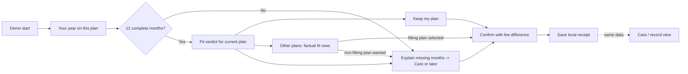

# Plan Review Snapshot

> **Repository preparation — 14 October 2026:** This is an individual candidate proposal dated 23 September 2026, not a recorded team decision. Current [V3 requirements](../作业要求.md) specify **OpenCode.ai + SAP APIs**. Build Apps/AppGyver/Build Code sections and their effort estimates below are retained as historical planning; API fit and revised implementation effort require validation. Local-only A1/A2 evidence is identified by source filename and is not bundled.

## An A3 candidate for an evidence-first annual mobile plan review

**Candidate ID:** RAE-FINANCIAL-SNAPSHOT
**Organisation / domain:** Spark New Zealand Limited / Financial
**Prepared for:** The group's later comparison of four A2-derived candidates
**Evidence checked:** 23 September 2026
**Status:** AI-assisted planning proposal. It is unranked and has not been selected by the group. No app development, tenant setup, user testing or submission has taken place. This file supersedes `A3_Candidate_Proposal_Rae_PathwayA_PlanCheck.md` (same day, earlier draft).

Plan Review Snapshot answers the question a customer receives once a year: **"Here is my last year on this plan. Does it still fit me?"** The app opens directly on a 12-month usage-and-spend snapshot. It applies a stated plan-fit rule to the current plan and shows the same factual checks for each alternative in a small demonstration catalogue. It then records the customer's explicit stay, change, help or later decision.

The customer does not type anything: every result comes from their own history. A Care view shows the same snapshot, so the customer and the agent read the same numbers.

The recommended classroom scope is a responsive web prototype of about five screens. It has one deterministic calculation, a data-sufficiency gate, all decision routes and a local decision record. It does not depend on live Spark systems.

Its purpose is to make the A2-D1 Release-1 mechanism observable and testable. That mechanism has three parts: validated history is shown before any decision, outcomes are logged, and no automated recommendation is made. A real Spark deployment would still need its own evidence on data quality, integration, commercial effect and retention.

| At a glance | Proposed position |
|---|---|
| Primary user | An individual pay-monthly consumer opening the annual plan-review summary. Classmates act as consumer proxies in classroom tests. |
| Secondary user | A Customer Care agent who reads the same snapshot and records an assisted outcome |
| Core working feature | 12 monthly records → sufficiency gate → snapshot metrics → plan-fit verdict for the current plan → the same factual fit check for each alternative → explicit decision and a saved receipt |
| Distinctive feature | No customer input is needed to get a result. The history is the input. A "keep my plan" outcome is treated as valid as a change. |
| Prototype data | Bundled fictional plans and synthetic 12-month histories. No credentials and no customer records. |
| Implementation | The SAP environment the course confirms: SAP Build Apps visual logic, or a small Build Code/SAPUI5 route (§4) |
| Planning estimate | **53–79 total person-hours**, including about 20% contingency (§8) |
| Main uncertainty | The course platform and package contract; whether the group prefers this or the overlapping PlanFit candidate (§9); the enterprise impact remains unproven |

---

## 0. How this candidate relates to the others

The group has four A2-derived candidates. I have seen two of the other three. This section only locates them; it does not compare quality.

| Candidate | Domain | Relationship to this one |
|---|---|---|
| **PlanFit Navigator Core** (Francis) | Strategic–Competitive | **Strong overlap**: same client journey (Spark mobile plan decision) and same A3 artefact type. The difference is in §9. |
| **Verified Knowledge Handover** (candidate-options document; author not named in the file) | Not stated in the file | Different process (employee exit and handover). No overlap. |
| Fourth candidate | Operational (assumed) | Not seen. `[V]` |

Because two candidates cover the same customer journey, the comparison agent should first settle **which mechanism** the group wants to demonstrate. There are two: evidence-first review (this candidate) and needs-based recommendation (PlanFit). After that, compare the result with the non-overlapping candidates.

---

## 1. Business rationale and evidence boundaries

The A1/A2 chain identifies a Financial-domain value leak in Spark's **publicly documented** annual plan-review journey. The summary is link-only, so the customer must fetch, clean and interpret 12 months of usage before judging plan fit. Every downstream outcome depends on the customer already having done that work (A2-D1 §2.3; A1-D2 §6).

This is an analytical finding about the documented path. It is not proof of how Spark's internal systems work. Public sources do not disclose Spark's internal recommendation rules, exceptions, process owner or event data (A1-D2 §1.5).

| Evidence | What it supports | What it does not establish |
|---|---|---|
| **Verified public benchmark:** the Commission's *Mobile Transparency Guidelines* (13 Nov 2025). The annual summary should contain at least: the period, total spend and usage, average and monthly spend and usage, current plan and allowances, and "the extent of any gap" between use and allowance. Percentages are recommended alongside counts. The alternatives prompt should be "based on at least 12 months of customer usage" and should "provide alternative plan information rather than directing consumers to a webpage". Usage information should be "no more than two clicks" from the front page. MNOs were expected to comply for pay-monthly customers at publication (Commerce Commission, 2025c, pp. 7–10). | The snapshot content list; 12 months instead of 6; no link-out; showing alternatives in the same units; a two-tap access limit | That Spark currently fails these guidelines, or that this prototype fulfils them in full |
| **Verified public context:** Spark's annual summary scored 73% in the Commission's 2024 transparency review, using six months of data. By October 2025 the Commission reported that Spark had discontinued its usage-based recommendation feature. 31% of mobile consumers had not switched because it was too much effort (Commerce Commission, 2024, 2025a, 2025b). | Regulatory and reputational pressure on this exact journey; the reason Release 1 stays factual rather than advisory | That plan-review friction causes churn or margin loss at Spark |
| **Interview evidence (A1-D2):** two matched semi-structured interviews using the same 22-question guide. One was a group-mate proxy; the other was an isolated GenAI respondent. Both rated the information/guidance gap **4/5**. Both chose an embedded 12-month snapshot as the first thing to test. The group-mate asked for "the 12-month usage picture, the cost split, the over/under counts, and a plain sentence saying what those numbers mean" (X. Zeng, personal communication, August 24, 2026, Q8). The GenAI respondent asked for typical use, variation, exceptional months, total cost and excess charges, "not merely an annual average" (A1-D2 Appendix C, Q20). | The snapshot metrics in §3 and the plain-sentence verdict. Also a design lead that the conclusion matters more than the click (Q9). | Population-level preference or causal effect. One human proxy and one simulated respondent are exploratory evidence only (A1-D2 §6.3). |

**Tension to record.** The 2025 guidelines say it is "preferable" for the prompt to suggest "the most appropriately sized plan" (Commerce Commission, 2025c, p. 9). A2-D1 deliberately deferred personalised recommendation to a gated Phase 2, because both interviews flagged trust and automation-bias risk (A2-D1 §4.3, §9.2).

This candidate's core scope takes a middle position. It shows **alternative plan information** for every catalogue plan in the same units, with a factual fit flag, but no ranking and no "recommended" label. An explicit "suggested size" is offered only as an optional increment (§2.3). The group should decide consciously which side of this line A3 sits on. The guidelines were published after my A2-D1 sources were fixed, so this is new evidence, not a contradiction of A2.

**Expected business value — an inference to test.** The customer spends less effort reconstructing their own year. Customers who are on a poorly fitting plan either way can see it. Care and the customer work from one set of numbers. Every outcome becomes countable against the A2-D1 KPI.

A downsizing lowers revenue from that customer. A2-D1 therefore treats ARPU and retention value as guardrails, not as benefits to maximise (A2-D1 §3.5).

A2-D1's illustrative case (≈NZ$576k annual benefit against a ≈NZ$160k fee) is built on **labelled assumptions, not Spark data** (A2-D1 §10.1, Table 9). It is not an A3 cost and it is not evidence the prototype can produce. A3 can show an understandable decision and reliable workflow behaviour; it cannot show a return on investment.

---

## 2. Scope: three slices and a recommended core

The A1/A2 scope covers all consumers who receive an annual plan summary. **This A3 slice covers fictional, individual, open-term pay-monthly plans with capped monthly data allowances, assessed on data only.** Calls and texts are displayed but not tested, and unlimited plans are excluded from the fit test (§3). This narrows the prototype without changing the upstream problem.

### 2.1 Slice options

| Slice | Contents | Estimate (incl. contingency) | Use when |
|---|---|---:|---|
| **Core — recommended** | Customer journey with snapshot, gate, verdict, alternatives, decision and receipt; plus a Care/record view showing the same snapshot | 53–79 h | The team can build shared state and conditional navigation reliably |
| **Lite — delivery-safe** | Snapshot, gate, verdict, and a keep/help/later decision with a receipt. No alternatives screen, no Care view. | 36–53 h | Platform access is late or experience is limited. The working rule and the SCR story are still intact. |
| **Plus** | Core, plus a process-owner count summary (§5) and/or an optional "suggested size" flag (§1 tension) | Core + 6–11 h | The Core passes every acceptance test by 12 October |

Decision rule: build Lite first as the first vertical slice, then extend it to Core. Lite is a strict subset of Core, so falling back costs nothing already built.

### 2.2 Core screens

| Screen | Customer or agent action, and visible result | Why it belongs |
|---|---|---|
| **0. Demo start** | Pick one of six fictional customers, or the Care view. A persistent notice reads "Course prototype — fictional plans and usage; no account changes". | Makes demo loading a separate control and avoids implying a link to MySpark |
| **1. Your year on this plan** | One screen: period covered (fixed demo date); a 12-month data chart against the allowance line; total and average spend with plan fees and extra charges shown separately; typical month, highest month, and months over and under allowance; calls and texts shown separately. | The guideline minimum content (§1). The metrics come from the interviews. Reached in one tap, within the two-click guideline. |
| **2. Does it fit?** | A plain-sentence verdict with the numbers behind it, e.g. "You used about 20% of your 40 GB on average and never went over." If data is insufficient, this screen instead explains which months are missing and offers help or later. | Makes the A2-D1 rule observable. Replaces the missing conclusion described in the interviews (Q9). |
| **3. Other plans** | Every catalogue plan in fixed allowance order and identical rows: what the average use would have been, months that would have gone over, the fit flag, and the plan-fee difference per year. No ranking, no badge. The customer can select one. | "Alternative plan information rather than … a webpage" (Commerce Commission, 2025c, p. 9), without automated advice |
| **4. Confirm and receipt** | Restates the choice, the fit result and the annual fee difference, then saves a local receipt. The receipt states the decision, the reasons, the data period, the rule version and that no plan actually changed. | Separates decision from fulfilment. Records the cost disclosure the A2-D1 change rule requires. |
| **C. Care / record view** | Choose a customer. See the same Screen 1–2 content read-only, plus that customer's saved decisions. Record an assisted outcome with a short reason code. | A2-D1's shared evidence basis for customer and Care (TO-BE Table 3) |

Decision choices: **keep my plan, change to the selected plan, talk to Care, or decide later**. These match the four outcomes logged in the A2-D1 TO-BE model.

"Change" can be confirmed only for a plan whose fit flag is true. A customer who still wants a non-fitting plan is routed to Care, and the receipt records it as the customer's choice. "Keep my plan" is always available, but when the current plan does not fit, the receipt does not call it suitable.

### 2.3 Required, optional and outside

**Required Core behaviour:**
- the calculation;
- the sufficiency gate;
- verdict text generated from the actual checks;
- all four decision routes;
- confirmation;
- receipt persistence with a visible save failure;
- reset to the fixtures;
- the Care view reading the same computed values.

**Optional after Core works:** process-owner counts (3–5 h); a "suggested size" flag that marks the smallest fitting plan (3–6 h, the group must accept the §1 tension first); one unlimited-plan customer whose usage is shown with the fit test marked not applicable (2–3 h).

**Outside this slice:** prepaid and 28-day periods; minutes and text fit tests; rollover, throttling and shared plans; roaming; device finance and contract exit fees; MySpark login; billing or CRM integration; real plan changes; e-mail or SMS delivery; retention offers; proactive targeting; market-wide comparison; any AI chat. The customer sees "within this demo catalogue", never "best plan".

---

## 3. A transparent rule that can actually be implemented

All thresholds below are **proposed classroom assumptions**: `[CONSULTING ASSUMPTION — VALIDATION REQUIRED]`. They restate the *draft* A2-D1 appropriate-choice rule, whose band is itself illustrative and marked for Stage-1 confirmation with Spark (A2-D1 §3.4). The app reports facts about past usage. It does not predict, optimise acceptance or sell up.

### Input and decision contract

1. **Fixed "as-of" date.** The demo runs as at 1 October 2026, so the period is October 2025 – September 2026. Results never depend on the device clock.
2. **Sufficiency gate.** A fit verdict needs exactly 12 monthly records for that period, each with non-negative data usage and a known plan fee. A missing month is **unknown, not zero**. With fewer than 12 months, the snapshot still shows the months it has and labels the period as partial (the guidelines allow a shorter first summary for recent joiners, p. 8). No verdict is produced, and the customer is routed to Care or later.
3. **Units.** Data is in GB of full-speed data and money in NZD. Money is held as integer cents; comparisons use unrounded values; display uses whole dollars or two decimals. Spend = plan fee + extra charges, shown separately (guidelines, p. 7).
4. **Snapshot metrics** for current plan *p* with allowance *A*:
   - total and average data;
   - median ("typical") month;
   - highest month;
   - over-months = count(used > *A*);
   - low-use months = count(used < 0.5·*A*);
   - average utilisation *U* = average(used) ÷ *A*;
   - total and average spend;
   - total extra charges.
5. **Fit rule (stay test).** A plan *fits* if **0.50 ≤ *U* ≤ 1.00** (both ends inclusive) **and over-months ≤ 1**. When evaluating an alternative plan *q*, use *q*'s allowance against the same 12 months.
6. **Alternative rows.** Show every catalogue plan other than the current one, in fixed allowance order. Each row shows *U*, over-months, the fit flag and the **plan-fee difference per year** = (fee*q* − fee*p*) × 12.
   - Historical extra charges are shown as a separate fact ("you paid $120 in extra data charges this year"). They are not netted into a forecast saving.
   - No sorting by price or fit, and no recommendation label.
7. **Change rule.** A change is *appropriate* only if the selected plan fits **and** the confirmation screen displayed its fee difference. The app records `disclosureShown = true` when the confirm screen renders. Keep is appropriate only if the current plan fits.
8. **Denominator.** Care and later outcomes are excluded from the appropriate-choice rate (A2-D1 §3.4, point 3). They are counted separately.
9. **Recording.** A receipt is written only after an explicit confirm. If the write fails, the app shows "not saved" with a retry and never shows a success receipt. A later confirm in the same review adds a new decision version and keeps the earlier one in history.

Because no user-editable inputs exist, the rule cannot receive invalid input from the customer. The error states that remain are insufficient data, a storage failure and navigating back. This is a deliberate simplicity trade-off, compared in §9.

### Fictional catalogue and repeatable cases

Plans are **fictional and not current Spark offers**. Every overage month adds a fictional NZ$10 data top-up to spend.

| Fictional plan | Monthly fee | Data allowance |
|---|---:|---:|
| S | NZ$35 | 5 GB |
| M | NZ$50 | 15 GB |
| L | NZ$65 | 40 GB |

The arithmetic below was checked by script on 23 September 2026.

| Case | Current plan / 12-month data (GB) | Expected result under these rules |
|---|---|---|
| **Aroha — justified keep** | M; 9,10,11,10,9,12,10,11,10,9,10,9 (total 120) | *U* = 66.7%, 0 over → **fits**. Alternatives: S 200%, 12 over; L 25%. Neither fits. |
| **Ben — justified downsizing** | L; 7,8,9,8,7,8,9,8,7,8,9,8 (total 96) | *U* = 20.0% → **does not fit** (under-used). M: 53.3%, 0 over, fits, **−NZ$180/yr** plan fees. S: 160%, does not fit. |
| **Chloe — justified upsizing** | S; 8,9,8,9,8,9,8,9,8,9,8,9 (total 102) | *U* = 170%, 12 over, NZ$120 extra charges → **does not fit**. M: 56.7%, fits, **+NZ$180/yr** plan fees, with the NZ$120 historical extras shown separately. L: 21.2%, does not fit. |
| **Dev — insufficient data** | M; only 9 months recorded | Partial snapshot, **no verdict**, Care or later offered. Must not be shown as "fits". |
| **Ema — no plan fits** | S; 2,2,3,2,6,2,2,7,2,2,6,2 (total 38) | *U* = 63.3% but 3 over → **does not fit**. M 21.1% and L 7.9% also do not fit, so **no plan fits** → explain and offer Care. This exposes a real calibration gap in the draft band, to report honestly. |
| **Boundaries (test-only)** | Fay: M, eleven months of 15 GB, one of 16 and one of 14 (total 180). Gus: L, twelve months of 20 GB (total 240). | Fay: *U* = 100.0%, exactly 1 over → **fits** (both upper limits inclusive). Gus: *U* = 50.0% → **fits** (lower limit inclusive). |

Ema is kept on purpose. A rule that can leave a customer with no fitting plan is exactly the kind of finding A2-D1 expected Stage 1 to confirm, and it is better shown than hidden.

---

## 4. Implementation and data plan

### Platform decision remains conditional

The A3 specification V1 names the SAP Build App environment "AppGyver" and asks for a ZIP "exported from the AppGyver" (INFOSYS 704 Teaching Team, 2026a, p. 1). The Canvas rubric and title refer to "SAP Build Code". Francis's platform note reports that Lab 8 V1 slide 8 still refers to AppGyver. I have not seen Lab 8 myself. `[V]`

SAP states that **SAP Build Apps is deprecated as a standalone product from 23 March 2026**. Existing contracts keep full access for their duration, but new instances cannot be provisioned after a contract expires. SAP's path forward is the unified SAP Build offering, including Build Code, with a tool that converts exported `.mtar` web apps into React or SAPUI5 (SAP, 2026a).

An `.mtar` export, an editable project and a ZIP are therefore not interchangeable. The format the course's "ZIP" means must be confirmed with staff.

| Component | If Build Apps access is confirmed | If Build Code is confirmed |
|---|---|---|
| Interface | Five pages; reusable verdict-card and month-row components; page and app variables; navigation | Small SAPUI5 web app in Business Application Studio |
| Catalogue, history and rule | Bundled lists in app variables; formula bindings for §3 metrics; conditional visibility | Bundled JSON and one pure calculation function |
| Chart | Marketplace chart component if the tenant has one `[V]`; otherwise bars built from containers whose height is bound to used ÷ max | SAPUI5 VizFrame, or the same container-bar approach |
| Record | On-device storage, with explicit read/write failure handling (SAP, 2026b, not fetched — see note) | Browser local storage behind one small record function |
| Verification | Fixture-driven preview checks, plus an independent re-import of the exported package | Unit tests for the rule plus a browser workflow check, plus an independent source-package run |

This mapping is an engineering proposal, not a tested implementation. On-device storage is local to one device or browser. It is not shared across devices and it is not an audit trail. The Care view therefore reads receipts saved **in the same browser** during the demo. That is honest for a prototype, and it must be said aloud in the pitch.

A production version would need identity, governed catalogue and rule versions, server-side calculation, durable records, access control and billing integration (A2-D1 §9, R1 and R5).

**First task after the group selects this candidate:**
1. Confirm the tenant, the permitted collaboration model, the package type and how the marker will open and run it.
2. Confirm that content is retained until marking (spec: "not to delete any content from AppGyver until marking is complete").
3. Prove that a one-customer, one-verdict page can be exported and then reopened by another member.
4. Each member saves one receipt and reopens it in the same browser.

Do this before building more screens.

### Minimal information model

| Record | Proposed contents | Evidence status |
|---|---|---|
| Plan fixture | Plan ID, name, monthly fee (cents), data allowance (GB), catalogue version | Fictional, bundled |
| Customer history | Pseudonymous customer ID, display name, current plan ID, monthly records (month, data GB, calls, texts, plan fee, extra charges) | Synthetic, bundled |
| Computed review | Review ID, customer ID, as-of date, sufficiency result, §3 metrics, fit flags per plan, rule version | Calculated from fixtures and declared rules |
| Decision | Review ID, version, actor (customer/Care), outcome (keep, change, Care, later), selected plan ID, fit result, `disclosureShown`, appropriate/not/excluded, timestamp, save status | Observed prototype actions only |

Do not put interview transcripts, participant names or credentials in the app package. Reopening the package must recreate every fixture; records persist only in the browser used. A visible **Reset demo** button clears the records and restores the fixtures.

---

## 5. Measurement without overstating what the app proves

The A2-D1 KPI definitions control downstream wording (A2-D1 §3).

| Event or measure | Prototype interpretation | Evidence limit |
|---|---|---|
| Invited | The customer is one of the seeded fixtures for this run | Not a Spark eligibility rule |
| Review opened | Screen 1 is shown for a customer; one review ID per customer per run | Seeing is not reading or understanding |
| Decision recorded | An explicit confirm saves a decision version | Browser closure records nothing; "no decision" says nothing about intent |
| Appropriate decision | A keep where the current plan fits, or a change to a fitting plan with the disclosure shown (§3.7) | It is appropriate only under the illustrative band |
| Effective completion rate (A2-D1 major KPI) | Optional count: appropriate decisions ÷ invited, shown **N/A** when the denominator is 0 | Demo counts come from testers choosing personas. They are **not** KPI evidence and cannot test the +5 pp target, which needs a controlled pilot against a link-only journey (A2-D1 §5.2). |
| Care contacts per completed review (guardrail) | Count of Care outcomes | Same limit |
| Fulfilment | **Not implemented.** The receipt says no plan changed. | A confirmed change never means an account changed |

Counting convention to validate: pressing back or reloading does not create a new review. A second confirm creates a new decision version and the latest version counts. Superseded versions stay visible in the Care view.

---

## 6. Design and validation approach

### Design Thinking evidence to produce

Use the five stages as an iterative loop (Dam, n.d.).

| Stage | Evidence already held | Evidence still to produce (pending) |
|---|---|---|
| Empathise | A1-D2 interviews; Commission reports and guidelines | Brief observation of 3–4 classmates reading a paper snapshot for a fictional customer |
| Define | H2 as refined in A1-D2 §6.3 | A one-line need: "see whether my plan still fits my real year without reconstructing it myself" |
| Ideate | Pathways A–D in A2-D1 §4.3 | Two paper variants compared: numbers only vs numbers plus a plain-sentence verdict. The choice is recorded. |
| Prototype | — | Lite, then Core, in the confirmed SAP environment |
| Test | — | The acceptance tests below and one usability round, with before/after changes recorded |

Do not recruit Spark employees. The Week 3 announcement prohibits contacting employees of the selected company (INFOSYS 704 Teaching Team, 2026c).

Francis's note reports a Week 6 announcement that restricts GenAI-written core intellectual content. I have not verified it locally `[V]`. Treat this document as AI-assisted planning, and confirm permitted GenAI use before any generated material becomes assessed content.

### Usability choices

- A restrained palette in the spirit of Spark, without the official logo `[V]`.
- Fit, does-not-fit and insufficient states never rely on colour alone: each has an icon and words.
- The same row structure for every plan.
- On a phone, stacked cards with repeated labels; on a laptop, the chart beside the metrics.
- The verdict sentence comes first; the reasoning expands underneath.

Specific uses of Nielsen's (1994) heuristics:

| Check | Proposed design response |
|---|---|
| 1. Status | The period covered is always shown; saved and not-saved states are distinct |
| 2. Familiar language | "You used about a fifth of your data", with percentages and GB counts together, as the guidelines recommend |
| 3. Control | Back, decide later and Care are available from every decision screen; nothing is lost going back |
| 4. Consistency | One verdict card and identical plan rows everywhere, including the Care view |
| 5. Prevention | The gate blocks verdicts on incomplete data; change is confirmable only for fitting plans; the fee difference appears before confirm |
| 6. Recognition | A compact summary of the year stays visible on Screens 3–4 |
| 7. Efficiency | A customer whose plan fits can finish in two taps (Keep → Confirm) |
| 8. Focus | One conclusion per screen; details are expandable |
| 9. Recovery | Insufficient data explains which months are missing; a save failure explains and offers a retry |
| 10. Help | "How is this worked out?" shows the rule, the period and the catalogue caveat |

### Proposed acceptance tests — none executed yet

| Test | Expected observation / proposed acceptance criterion |
|---|---|
| Rule cases | Aroha, Ben, Chloe, Dev, Ema, Fay and Gus give exactly the results in §3; the verdict sentence matches the computed flags |
| Boundaries | Fay (100%, 1 over) and Gus (50%) fit; changing one Fay month to 16 GB (2 over) flips her to does-not-fit |
| Sufficiency | Any missing month → no verdict, and the missing months are named; never treated as 0 GB |
| Disclosure | A change cannot be confirmed before the fee difference renders; the receipt records `disclosureShown` |
| Decision branches | Keep, change, Care and later each reach a receipt; a non-fitting change request routes to Care |
| Shared evidence | The Care view shows numbers identical to the customer view for every fixture |
| Recording failure | Blocked storage shows "not saved" and a retry; no success receipt appears |
| Repetition and reset | Back, reload and double-tap do not duplicate reviews or decisions; reset restores the fixtures |
| Reproducibility | Another member imports the submitted package in a fresh approved environment and reproduces all cases |
| Usability | One round of 4 classmates outside the build team. At least 3 of 4 state correctly, unaided, whether Ben's plan fits and why, within 90 seconds of opening. Everyone understands that no real plan changed. Record failures and retest the affected tasks. |

These thresholds are planning targets, not course requirements or statistical evidence. Also check keyboard use, visible focus, contrast, 200% zoom and one phone-width viewport.

---

## 7. Fit with the latest A3 requirements

The facts below are from the A3 specification V1 and the Canvas assignment page. The evidence column describes future work, not achieved rubric coverage.

| A3 criterion | Weight | Evidence this candidate could produce |
|---|---:|---|
| Rationale | 5% | Traceability to A2-D1 Pathway A, placed top-left on A2-D1's Impact–Effort plot (enterprise Impact 9 / Effort 3, illustrative). The group's own common-criteria matrix across four candidates is still to be done (§9). |
| Design | 15% | Interview-derived snapshot content; the numbers-vs-verdict paper comparison; Spark-specific language and regulatory context; recorded test-driven changes |
| Functionality | 30% | A real calculation. Switching customer changes every metric, flag and route. The gate, disclosure rule and receipt are all observable. |
| Usability | 25% | Short journey, two-tap keep path, exception routes, heuristic review and observed task results |
| Presentation | 25% | A rehearsed five-minute CEO-facing SCR pitch with a live demo |

Course facts to plan around:
- The PDF is marked out of 200, while the rubric screenshot totals 100. The relative weights agree.
- The PDF sets **ZIP: Mon 19 Oct 2026, 11:59 AM** and **slides: Tue 20 Oct, 11:59 AM**. The Canvas page shows **Oct 20, 23:59**. Plan to the earlier times until staff confirm.
- There is "no extension possible".
- The slides must end with the Groupwork Management Disclaimer, using real contribution percentages.

### A possible five-minute demonstration

| Time | Content |
|---|---|
| 0:00–0:40 | **Situation:** once a year, every Spark pay-monthly customer is asked to review their plan; the Commission is watching this journey |
| 0:40–1:10 | **Complication:** today the customer gets a link and has to reconstruct their own year. The 73%/6-month score and the discontinued feature. State the evidence boundary. |
| 1:10–1:30 | **Resolution:** evidence first, facts not advice; why this candidate was chosen (group matrix) |
| 1:30–3:30 | Live demo: Ben (under-used → other plans → M fits, −$180/yr → confirm → receipt); Dev (gate); Care view showing the same numbers |
| 3:30–4:15 | Test results and the changes made; Ema as an honest rule limitation |
| 4:15–5:00 | Next decision: a controlled pilot against the link-only summary on the A2-D1 KPI; groupwork slide |

A recorded backup protects against environment failure but does not replace the live demo.

---

## 8. Workload and delivery plan

**Estimate basis:**
- four students and one approved SAP environment;
- local data only, with six customers and three plans;
- no backend, API or login;
- some familiarity from the Learning Journeys;
- one integrator.

Team skills and available hours are unverified. These are estimates, not measured velocity.

| Work package | Person-hours | Completion evidence |
|---|---:|---|
| Platform/package check and early export–reopen proof | 4–6 | Agreed run contract; one page exported and reopened by another member |
| Design Thinking material, paper variants, screen design | 6–8 | Need statement, two variants compared, five-screen design |
| Fixtures, rule specification, expected-results sheet | 4–6 | §3 cases reproduced independently in a spreadsheet |
| Screens 1–4 and calculation (Lite, then Core) | 12–18 | All cases correct on screen |
| Decision records, Care view, save failure, reset | 5–8 | Correct save/reopen/reset; Care view identical |
| Usability round, accessibility checks, fixes | 7–10 | Observation notes, defects, retests |
| Final packaging and independent reproduction | 2–4 | The submitted package opened and run by a non-author |
| Pitch, backup recording, timed rehearsals | 4–6 | SCR deck, demo script, real contribution record |
| **Subtotal** | **44–66** | |
| **About 20% contingency** | **9–13** | Platform learning, chart component, defects |
| **Planning envelope** | **53–79** | About 13–20 h per person if split evenly |

Lite alone is about 30–44 h before contingency, or 36–53 h with it. Optional increments are listed in §2.3.

**Proposed sequence (calendar dates assume selection by 29 Sep `[V]`):**

| By | Milestone |
|---|---|
| Wed 30 Sep | Platform/package contract confirmed; export–reopen proof done |
| Fri 2 Oct | Paper variants tested; fixtures and expected-results sheet agreed |
| Fri 9 Oct | Lite working end to end with all §3 rule cases |
| Mon 12 Oct | Core complete (Screen 3, Care view, receipts). Go/no-go on Plus. |
| Thu 15 Oct | Usability round done, fixes applied, feature freeze |
| Sat 17 Oct | Independent reproduction of the final package; backup recording; slides v1 |
| **Sun 18 Oct** | Package ready, a day ahead of the earlier PDF deadline |
| Mon 19 Oct 11:59 AM | ZIP submitted |
| Tue 20 Oct 11:59 AM | Slides submitted; Lab 12 pitch |

Possible responsibilities: requirements and testing; interface and visual design; rule and data; integration and release. Pair a non-author with every verification task. Contribution percentages come from actual work, not from this plan.

**If time runs short,** cut in this order: Plus → the Care assisted-outcome entry (keep it read-only) → Screen 3. That leaves Lite. Never cut the gate, the verdict sentence, the save-failure message, the independent package check or the usability fixes.

---

## 9. Information for the later comparison agent

| Comparison factor | Evidence-backed candidate position | What could change the assessment |
|---|---|---|
| Traceability | Direct: A2-D1 Pathway A Release 1, its TO-BE elements (gate, shared evidence, outcome logging) and its KPI definitions | The group matrix ranks another problem higher |
| External anchor | Strong: the snapshot content follows the Commission's 2025 annual-summary minimum and the 12-month basis almost item by item | Staff want more than a regulatory rationale |
| Classroom feasibility | Deterministic rule, no user inputs, six fixtures; 53–79 h with a Lite fallback at 36–53 h | Tenant or package restrictions; the chart component |
| Demonstrability | Switching customer visibly changes every result. Ben, Dev and Ema show a fitting change, the gate and an honest limitation within two minutes. | Markers weigh user-entered interaction more heavily |
| Main trade-off | No inputs means fewer error states and a very reliable demo, but less interactive richness than an input-driven tool | Staff feedback that "functionality" means data entry |
| Evidence confidence | Strong on provenance, the regulatory benchmark and the course requirements. Exploratory on customer preference (two interviews). No implementation evidence yet. | Real prototype tests and permitted user feedback |

**Overlap with PlanFit (Francis):**

| Aspect | Plan Review Snapshot | PlanFit Navigator Core |
|---|---|---|
| Starting point | The customer's own 12-month history | The customer states budget, expected use and buffer over 3 months of usage |
| Output | Factual fit flags for every plan, unranked | The cheapest qualifying plan is recommended, with an explanation |
| A2 mechanism | Evidence first; recommendation deferred (Pathway A) | Explained recommendation / decision readiness (H1M) |
| Regulatory hook | Annual-summary content (Outcome 2b) | Alternative-options prompt and sizing (Outcome 2c) |
| Rule complexity | Low: one band, no user inputs | Higher: eligibility, add-ons, uncertainty, stale-confirmation checks |
| Interaction richness | Lower | Higher |

The two are complementary. This candidate's Screen 1 could replace PlanFit's three-month usage screen, and PlanFit's budget and buffer inputs could become an optional increment here. The comparison agent should score each on its own before considering a merge. A merge increases scope and must be re-estimated.

**Cautions for the agent:**
- Use **impact and effort** as the matrix axes, with common definitions across all four candidates.
- Do not reuse A2-D1's enterprise Impact 9 / Effort 3 as an A3 score. It compared pathways *within* one problem, not candidates *across* problems.
- Keep enterprise effort separate from classroom prototype hours.
- Do not label this a "quick win" just because synthetic data makes it easy to build.

This candidate is ready to enter comparison as a **conditional implementation proposal**. No comparative score is supplied here.

---

## 10. Open items before selection

1. What is the fourth candidate, and who authored the knowledge-handover candidate? `[V]`
2. What package does "ZIP exported from AppGyver" mean — `.mtar`, a project ZIP or Build Code source? How will the marker run it? `[V]`
3. Does the lab tenant give Build Apps or Build Code access, and is a chart component available? `[V]`
4. Which deadline is binding, PDF or Canvas? `[V]`
5. Should A3 stay strictly factual (A2-D1 stance), or adopt the guideline's "suggested size" (§1 tension)? This is a group decision.
6. May the Spark name and colours appear? Default: name and palette, no logo. `[V]`
7. What GenAI use is permitted for A3 content? `[V]`

---

## References and source locators

**Course sources**

- INFOSYS 704 Teaching Team. (2026a). *A3: Build app specification and marking criteria* (V1), pp. 1–2. University of Auckland. Local: `INFOSYS704/Assignments/A3/00_Official/704_A3_2026 Build App_Specificatication and Marking Criteria_V1.pdf`.
- INFOSYS 704 Teaching Team. (2026b). *A3 Build Code* [Canvas assignment page and rubric]. Screenshots supplied by the author, 23 September 2026 (due Oct 20 23:59; rubric criteria and bands).
- INFOSYS 704 Teaching Team. (2026c). *Welcome to Week 03* and *Group formation for A3* [Announcements]. Local capture: `INFOSYS704/00_Course_Admin_Official/Canvas_Live_Captures_2026-08-15/INFOSYS704_Canvas_Announcements_Raw_Text_2026-08-15.txt`.
- INFOSYS 704 Teaching Team. (2026d). *Groupwork management disclaimer* [Slide template]. Local: `INFOSYS704/Assignments/A3/00_Official/Groupwork Management Slide.pptx`.
- Lee, F. (2026). *PlanFit Navigator Core: A3 candidate proposal* [Group working document, 23 September 2026]. Reports on Lab 8 V1 and the Week 6 GenAI announcement are cited from it and not independently verified.

**A1/A2 evidence (the author's own submitted work)**

- Huang, R. (2026a). *A1-D2: Spark — Financial* [Submitted assignment]. Local: `INFOSYS704/Assignments/A1-D2/01_Submission_Record/A1-D2_Spark_Financial_Rae_Huang_xhua725.docx`. §6.3 hypothesis decision; Appendix B, Q8–Q9 (group-mate); Appendix C, Q20–Q21 (GenAI); Appendix D (TO-BE design interview).
- Huang, R. (2026b). *A2-D1 consulting proposal* [Final working copy]. Local: `INFOSYS704/Assignments/A2-D1/work/A2-D1_Consulting_Proposal_Rae_Huang_xhua725.docx`. §2.3, §3.2–3.5, §4.3–4.4 (Tables 2–3), §9.2, §10.1 (Table 9). Matrix scores: `.../A2-D1/work/build_a2d1_excel_full.py`, Impact-Value sheet.
- Huang, R. (2026c). *A2-D2 business case presentation* [Slides v3]. Local: `INFOSYS704/Assignments/A2-D2/work/A2-D2_Slides_v3.pptx`.
- Per course staff guidance, A1/A2 documents are not listed in an assessed reference list. They are located here for internal verification only.

**Public evidence and methods**

- Commerce Commission. (2024, November 27). *Is your mobile plan right for you? Telcos could do more to tell you.* https://www.comcom.govt.nz/news-and-media/news-and-events/2024/is-your-mobile-plan-right-for-you-telcos-could-do-more-to-tell-you/
- Commerce Commission. (2025a, March 20). *ComCom calls for better switching for consumers.* https://www.comcom.govt.nz/news-and-media/news-and-events/2025/comcom-calls-for-better-switching-for-consumers/
- Commerce Commission. (2025b, October 2). *Spark, 2degrees and One NZ stall on billing transparency.* https://www.comcom.govt.nz/news-and-media/news-and-events/2025/spark-2degrees-and-one-nz-stall-on-billing-transparency/
- Commerce Commission. (2025c, November 13). *Mobile transparency guidelines.* https://www.comcom.govt.nz/assets/Documents/review-of-consumer-mobile-bills/Mobile-Transparency-Guidelines-13-November-2025.pdf. Printed pp. 7–10 (Outcomes 1–2, implementation schedule). Text extracted and checked 23 September 2026.
- Dam, R. F. (n.d.). *The 5 stages in the design thinking process.* Interaction Design Foundation. https://ixdf.org/literature/article/5-stages-in-the-design-thinking-process
- Nielsen, J. (1994, April 24). *10 usability heuristics for user interface design.* Nielsen Norman Group. https://www.nngroup.com/articles/ten-usability-heuristics/

**SAP platform sources, retrieved 23 September 2026**

- SAP. (2026a). *SAP Build Apps deprecation and the path forward* [SAP Community blog]. https://community.sap.com/t5/technology-blog-posts-by-sap/sap-build-apps-deprecation-and-the-path-forward/ba-p/14351750. The matching SAP Help page (https://help.sap.com/docs/build-apps/service-guide/sap-build-apps-path-forward) did not render for automated retrieval.
- SAP. (n.d.). *On-device data storage.* https://help.sap.com/docs/build-apps/service-guide/on-device-data-storage. Did not render for automated retrieval; the device-local behaviour stated in §4 is also reported in Francis's platform note. `[V]`

**Validation status:** The following have been checked: the proposal's consistency with A1-D2 and A2-D1, the Commission guideline wording and page numbers, the SAP deprecation date and terms (community source), fixture arithmetic (script, 23 Sep) and workload totals. Still untested: app behaviour, export/import, storage, the chart component, usability results, the group selection and any business outcome. This is a candidate proposal, not a submission draft.
