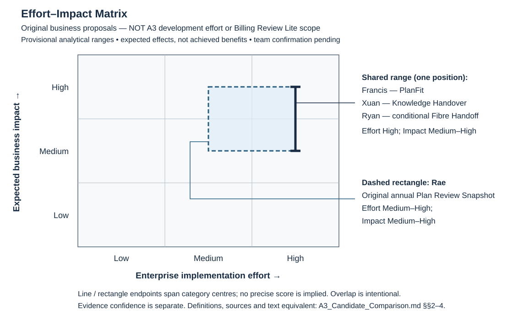

# A3 选题工作表

**更新：** 15 October 2026（Issue #11 四方案比较与提议记录；不是团队会议日期）<br>
**当前阶段：** 比较文档完成；已有 Billing Review Lite 实施方向，团队最终确认尚待取得；不是 Submission Draft。<br>
**选择状态：** **Proposed by Francis; pending confirmation by the full team.**<br>
**公司：** Spark New Zealand Limited。  
**依据：** [作业要求与 rubric crosswalk](../作业要求.md)、Live Master (source file: `Master_Consistency_Table.md`; not bundled)、Staff ED-QA-006A（23 September live Ed 复核）、Lab 7 slide 10/13、Lab 8 slide 8。

## 2026-10-06课程变更控制

当前V3已明确OpenCode.ai + SAP APIs及ZIP交付。6 October采用的[Pool v3](<../resources/api/SAP API Pool v3.xlsx>)作为历史保留；本轮使用已原样复制并核对哈希的[Pool v4](<../resources/api/SAP API Pool v4.xlsx>)（Sheet1第7–28行，22条）。完整来源、字段/实际响应/浏览器证据分层见[英文比较 §5](A3_Candidate_Comparison.md#5-sap-api-pool-v4-feasibility-and-evidence-levels)。独立完整运行、最终API适配及团队决定仍有未验证项。

比较各候选前，分别登记适用API技术名/所需字段、功能关系、无法满足的需求及Option1/2/3。按Ed #44在同company/domain调整或改选；全新方案另需AS-IS/TO-BE。所有评分和最终选择保留真实团队证据，不由此工作表代填。

## 1. 本轮要完成的决定

将四位成员已有的 A1/A2 problem/solution 放在同一张比较表中，用 Effort–Impact Matrix 支持选择一个实施方案。四个 domain 是候选来源；分析不等于真实团队决定。现有[英文四方案比较](A3_Candidate_Comparison.md)含原始来源索引、[矩阵](A3_Effort_Impact_Matrix.svg)、独立A3可行性表、推荐及敏感性分析，供实际团队审阅。

四份候选及原始A1/A2已入库；14 October的[PR #3](https://github.com/Francis-Lee-210/INFOSYS-A3/pull/3)更正原 Kevin/Ryan 文件标签对调，本轮以署名作业及manifest再次核对。Francis提议继续Billing Review Lite，Xuan的Knowledge Handover为首选fallback；不是全队选定，也不证明其他企业方案价值较低。

## 2. 每位组员提供的最小信息

将 [简短提示词](A3_组员Agent提示词.md) 的第一段发给每位组员，让其在自己的 A1/A2 上下文中自由生成候选实现方案。收齐方案后，使用第二段交给同一个 Agent 统一比较并提出推荐；最终选择由小组确认。下方工作表可供参考，不是各 Agent 必须照填的输出模板。

可先用以下格式各写五行，或提供已有 A2 材料路径：

```text
Name / Domain:
Business problem and target user:
Proposed solution:
One core app workflow (input -> processing/action -> output):
Supporting evidence and data/system dependencies:
```

另外记录现有开发进度、OpenCode/API访问情况、可投入时间。缺失信息保留为待确认，不代写为既有事实。

## 3. 候选登记

| 成员/domain | 原问题与方案 | 可讨论的核心功能 | 已有支持与主要缺口 | 小组选择状态 |
|---|---|---|---|---|
| Francis Lee — Strategic/Competitive | Consumer mobile plan-value review; [PlanFit Navigator Core](../candidates/A3_App_Candidate_Options-Francis.md) | usage/needs → explained keep/change/help → explicit decision/receipt | [原始作业](../references/Francis/README.md)已核对；产品/订单可提供上下文，但价格/allowance/usage/eligibility映射未验证；旧平台工时不作为当前承诺 | 暂缓提议；团队待确认 |
| Xuan Zeng（候选文件标签 Kevin） — Organisational | [Verified Knowledge Handover](../candidates/A3_App_Candidate_Options-Kevin.md) | employment case → receiver/pack → competence → verified/remediation | [原始作业](../references/Xuan_Zeng/README.md)已核对；v4 ECEmploymentInformation及官方EmpEmployment字段是合理线索，sandbox访问/样本待验证；表单不能证明知识转移或节省 | **首选fallback提议**；团队待确认 |
| Ryan Li — Operational | [Fibre Handoff Desk](../candidates/A3_App_Candidate_Options-Ryan.md) | conditional referral → information request/acceptance → retest/reopen | [原始作业](../references/Ryan/README.md)及Concise版A2-D2已核对；先诊断再选干预；Project/Order不等于fault/恢复；合作方与事件语义待验证 | 暂缓提议；非否定协调价值 |
| Rae Huang — Financial | [原Plan Review Snapshot](../candidates/A3_App_Candidate_Options-Rae.md) → 当前Billing Review Lite适配 | one record → amount/source/gaps → sufficiency → explicit intention/receipt | [原始作业](../references/Rae/README.md)已核对；#5真实reader及#6受控测试支持有限范围；不支持年度usage/plan fit；#7/#8未完成合并验收 | **Francis提议继续Lite；全队待确认** |

四行均以原始A1/A2为优先来源，详细定位见[英文来源索引](A3_Candidate_Comparison.md#9-traceable-source-index)。企业预算/周期与课堂原型不等价；候选自评、GenAI回答、目标KPI及情景ROI都不是独立业务效果验证。Live Master本轮未访问/改写。

## 4. 共同评估口径

以下是本轮统一的定性分析口径，**不是教师规定的数值评分量表，也不是团队投票**。先比较原企业方案，再独立检查A3可行性；不为支持Lite而改变标准。

| 维度 | 讨论问题 | 要留下的依据 |
|---|---|---|
| Business impact | 解决哪个明确业务需要？影响谁、哪个结果？证据支持程度如何？ | 原有 A1/A2 论证及关键来源；把预期效果标为预期 |
| Implementation effort | 方案涉及哪些步骤、数据、接口、规则和团队技能？ | 相同范围下的工作量与依赖清单 |
| A3 prototype feasibility | 在指定OpenCode + SAP APIs路径上，能否按时做出至少一个working feature？ | 可演示的输入—处理—输出流程；平台、数据和导出可行性 |
| Demonstrability and usability | 五分钟内能否让观众看清业务问题、操作流程与结果？ | 精简演示路径、主要错误/返回路径、可测试的成功标准 |
| Evidence and uncertainty | 哪些是已知事实、咨询假设或测试数据？哪项未知会改变选择？ | 证据标签及待验证问题 |

Effort–Impact Matrix 的两个轴仍是 **impact** 与 **effort**。开发可行性、数据可得性和演示清晰度作为配套检查，不暗中改成额外轴或教师指定权重。

先比较业务方案的 impact/effort，再检查各方案的 A3 原型可行性。不要用某方案的完整企业实施成本，去比较另一方案只做课堂演示的成本；也不要把课堂开发方便直接等同于较高业务价值。

本轮不用1–5分、精确坐标或加权总分。Impact为原方案预期效果的范围/重要性/因果机制；Effort为企业实施的数据、集成、角色、外部协作、流程及治理依赖。Low为局部收益/少依赖，Medium为有实质意义的有界流程/多角色有限集成，High为显著重复或广泛效果/高度相互依赖和治理 rollout。Medium–High表示不确定范围；证据置信度另列，High潜力不等于已验证效果。详见[英文定义及理由](A3_Candidate_Comparison.md#2-common-matrix-definitions)。

| 原企业候选 | Impact | Enterprise effort | 依据与置信边界 |
|---|---|---|---|
| Francis — PlanFit | Medium–High | High | 决策/留存潜力；usage、plans、eligibility、推荐与有效试验依赖大；单一consumer proxy不证明留存 |
| Xuan — Knowledge Handover | Medium–High | High | 减少知识流失/rework潜力；跨角色真实验证、治理与推广复杂；小规模配置不等于低企业总依赖 |
| Ryan — conditional Fibre Handoff | Medium–High | High | fault协调/recontact潜力；根因、合作方、系统/事件语义尚待诊断 |
| Rae — **原年度Snapshot** | Medium–High | Medium–High | review completion潜力；少推荐逻辑但年度数据、Care、隐私与规则验证依赖仍大 |



文字等价：四者impact均为Medium–High；Francis/Xuan/Ryan完全重叠于High effort范围；Rae effort为Medium–High并与前三者重叠。初始分析范围全部保留，没有为画面强行分四象限。现有代码仅减少剩余课堂开发，不增加impact。完整[A3可行性表与敏感性分析](A3_Candidate_Comparison.md#6-separate-a3-feasibility-comparison)另列。

## 5. 团队讨论顺序

1. 每位成员介绍自己已有的 problem、solution、最强依据和主要依赖。
2. 统一比较范围与 impact/effort 定义，逐项讨论四个方案。
3. 将候选放入矩阵，检查关键假设改变时排序是否会变化。
4. 对优先候选明确一个端到端 working feature，核实课程平台与导出可行性。
5. 记录选中一个方案的理由、其余方案暂缓原因、组员意见及尚未解决的问题。

## 6. 2026-10-15 提议与A3范围适配记录 — 全队确认待办

| 项目 | 记录 |
|---|---|
| 现行实施方向 | #4 Billing Review Lite；main基线 `e3c18a5783c82515fddc7f5942696ee266e054a2`已合并#5/#6，不等于团队批准 |
| 提议人/日期 | Francis；2026-10-15在当前讨论确认继续Lite及fallback提议。不是团队会议或全队确认日期 |
| 提议方案 / 选择状态 | Billing Review Lite；**Proposed by Francis; pending confirmation by the full team.** |
| 实际团队会议/参与者/意见/分歧处理 | 无可核验记录；不预填他人同意、出席、票数或意见 |
| 全队确认/日期 | **待Francis、Xuan、Ryan、Rae实际审阅确认；确认日期未记录**。需审阅比较、API证据、缩水价值/模型改动、未完成流程与fallback条件 |
| 选择依据与候选比较 | [英文比较及来源](A3_Candidate_Comparison.md)；有真实API reader证据、明确字段契约、可解释证据优先机制及可验证的有限流程；并非原企业价值最高，也不是只因已有代码 |
| 与 A2 的连接与Option分类 | Rae Financial：呈现证据 → 判断充分性 → 记录明确意向。Option 2为同Spark/Financial的**工作分类**，不是Staff对本适配的批准；若实质变成全新问题，复审Option 3和新AS-IS/TO-BE要求 |
| 当前价值/起点/终点 | 帮助用户理解一条financial/billing-request record的金额、来源、证据缺口，并记录后续review意向；从连接/选记录到本地历史receipt（完整终点尚待实施验收） |
| 保留 / 修改 / 延后 | 保留evidence-first与显式意向；年度snapshot改为单record amount/source/gaps；延后annual usage、allowance/fit、推荐、节省计算、真实plan change及Care portal。#12须补模型改动和真实walkthrough；#15最终ratification |
| 数据与实际实现边界 | `API_BILLING_DOCUMENT_REQUEST_SRV`；request不是已开/已付bill，sandbox不是已证实Spark真实客户。#5历史真实list/detail；#6的34组受控浏览器测试不是新live SAP验收。main有选取/解释/Back；#7 PR #21仍开放，#8开放，二者仍由Rae负责；不改其实现 |
| 失败/重选条件 | 数据契约无法复现、解释误导或Financial业务连接失去可信度、意向/receipt流程无法完成时复审；不能用fixture冒充live。Xuan为首选fallback，需验证employment访问/合适样本；若其验证迅速通过，应重新比较而不保护沉没代码 |
| 外部Live Master/个人作业级联 | 本仓库以此表记录A3变更。外部Master位置未建立，待实际负责人同步；不猜路径，不修改个人A1/A2或原候选；团队确认后再决定后续级联 |
| 最终平台、导出格式与截止 | 见作业要求中的未解决官方冲突 |
| 下一阶段分工 | 待按实际能力与时间共同安排；不预填贡献比例 |

## 7. 选题完成条件

- [x] 四份候选及各成员A1/A2已入库，Kevin/Ryan归属及manifest核对完成。
- [x] 比较口径一致，Effort–Impact Matrix 有证据、理由及文字等价；独立A3表不混用enterprise benefits/工时。
- [ ] 小组实际选择了一个方案并记录决定。
- [x] 至少一个核心 working feature 的范围和成功标准可说明（不代表完整流程验收通过）。
- [ ] 开发平台、关键数据依赖和导出方式足以支持下一步设计。

逐条[Issue #11验收映射](A3_Candidate_Comparison.md#8-authentic-decision-status-and-issue-11-acceptance)：文档完成不等于issue完成；真实团队确认仍开放，最终级联/外部同步部分完成。以上不证明A3完成、rubric通过或提交；#12设计、后续integration/live/package与最终材料另行完成。

## 8. 2026-10-16 状态追加 — 四人真实评论确认已记录

保留以上15 October提议/待确认的历史记录，不回写成更早的团队决定。现已核对#11四条实际评论：Francis、Rae、Xuan、Ryan均确认PR #22范围的Billing Review Lite；实际账号、UTC时间、签名及直接链接统一记于[英文决策记录§11](A3_Candidate_Comparison.md#11-dated-confirmation-update--16-october-2026-nzdt)。最后一条为15 October 13:59:04 UTC，即16 October 02:59:04 NZDT。此为异步确认，不是会议/出席证明；没有代组员发言或代填批准。

Rae关于“不将A2预计收益写成原型成果”的条件和Xuan Knowledge Handover首选fallback均保留。Option 2仍是工作分类，#15须结合#9/#10真实证据完成最终API-fit/route ratification；不是Staff批准。#12新增设计/模型变更及独立wireframe属于当前review，不是这些较早评论已测试或批准的材料。真实human walkthrough和必要Signavio构建/导出仍待完成；不关闭#11/#12、不改组员assignment、不改个人A1/A2或外部Master。当前main `7a368f5`已包含#7/#8及item-retry修复，与以上旧基线状态区分。
