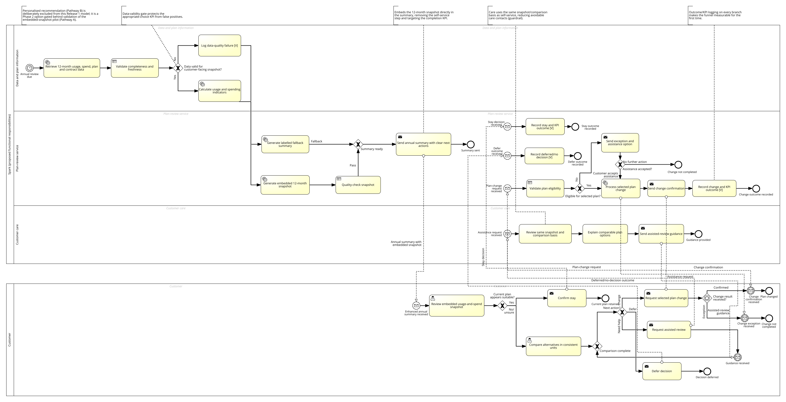

# Original model and Lite adaptation handoff

16 October 2026 NZDT. [Rationale/map](issue-12-design-rationale.md#2-original-to-lite-mechanism-map) · [New simplified process map](issue-12-process-adaptation.svg) · [Walkthrough](../validation/issue-12-walkthrough.md).

## 1. Original evidence—not a recreated “original”

- Rae's [A1-D2](../../references/Rae/A1-D2/A1-D2_Spark_Financial_Rae_Huang_xhua725.docx), **§8.2, Figure 4a** displays the title **`INFOSYS704_A1-D2_TO-BE_Spark_Financial_Optimised_v2`**. Figures 4b/4c enlarge dispatch/KPI/change-exception and customer-choice/assistance paths. Section 8.2 explicitly specifies main flow 1–16.
- Her later [A2-D1](../../references/Rae/A2-D1/A2-D1_Consulting_Proposal_Rae_Huang_xhua725.docx), **§4.4 Figure 2**, details A–C and **Table 3**, carries the annual TO-BE and efficiency/KPI interpretation. **§4.3/Table 2** chooses Pathway A. The embedded images were visually inspected, not inferred from text extraction.
- Both images visibly separate a Spark pool (Data and plan information; Plan-review service; Customer care) from Customer, with annual timer, data-validity/fallback, snapshot, suitability/comparison, change eligibility/exceptions, assistance, stay/defer/change outcomes. A1-D1 §3.7 Figure 7 and A2-D1 §2.3 Figure 1 show the different link-only AS-IS. A1-D2's TO-BE overview clips some far-right end labels; the enlarged panels and A2 details provide the readable corresponding paths. No absent label is reconstructed as an authenticated original.
- R2 §8.2 **reports** that Signavio Convention Check passed at original export. That author statement is not an independent check performed by this task. The editable Signavio project/model ID, access and machine-readable BPMN are **not bundled**; no authenticated Signavio workspace was accessed.
- [A2-D2](../../references/Rae/A2-D2/A2-D2_Business_Case_Slides_Rae_Huang_xhua725.pptx) slide 3 uses the AS-IS image; slide 7 uses the same image bytes as A2-D1 Figure 2 with crop (`r=64750,t=8300,b=74600` in slide XML), exposing the data gate rather than a new model. Its slide 14 benefits are assumptions.

### Readable archived image

`issue-12-original-tobe.png` is a **byte-identical extraction**, not redrawn or relabelled: archive `references/Rae/A2-D1/A2-D1_Consulting_Proposal_Rae_Huang_xhua725.docx`, zip entry `word/media/image2.png`, 3150×1612 pixels. SHA-256: `c34cbcd44fdc667d6744d43b0f3ed5f623dcb2cacd137d2d8fdb3a10fd0e7ac3`. Source QA checks it against that zip entry and `ppt/media/image2.png` in the archived A2-D2. Use the original report's detail A–C for zoomed reading. The original Office documents and manifest hashes are unchanged.

## 2. New map: notation and responsibilities

[issue-12-process-adaptation.svg](issue-12-process-adaptation.svg) is a **new simplified process map**, **not BPMN**, not a Signavio export and not a claim of a new Convention Check. Rounded rectangles are steps, labelled arrows are control/return routes, dashed connectors are read-only request/response; numbered return references avoid unreadable crossing lines. Labels distinguish retained principles, modified steps and deferred mechanisms. The text equivalent follows so the picture is not the sole evidence.

| New node | Responsible actor / operation | Original-to-Lite change |
|---|---|---|
| L1 | Reviewer starts manually, sees source and loaded-page scope, selects one key. | Replace annual eligibility/timer; no customer identity claim (R2 §8.2 steps 1–2). |
| L2 | Loopback adapter validates GET destination/source and matching keyed header from SAP training source. | Replace annual pipeline with minimum single-header contract. Required failure E1 returns to L1 without a financial snapshot. |
| L3 | Browser explains original amounts/bases/currency/processing date and optional limitations. | Retain validation/explanation principle, remove annual usage calculations and suitability verdict (steps 3–9). Optional unavailability does not erase a valid header. |
| L4 | Reviewer corrects selection or requests a new evidence read. Browser clears the unconfirmed intention and suspends Continue while checking (E2). | New explicit pending/correction control; matching response returns to L3; obsolete generation is ignored. Back to L1 discards pending evidence. |
| L5 | Browser exposes evidence conflict, not “plan suitable?”. | Material currency/source/parent conflict permits Help/Later; otherwise four intentions. No comparison/eligibility engine (steps 9–13 deferred). |
| L6 | Reviewer chooses, reviews summary, corrects/backs, explicitly confirms. | Stay/change/assist/defer become Keep/Review options/Help/Later **intentions**, never actual execution (steps 10–15 modified). |
| L7 | Browser writes one minimal local receipt and validates read-back; failed save E3 is unsaved with manual Retry. | Modified outcome recording; no A2 KPI/appropriate-choice measurement. A changed evidence read clears cached unsaved intent before any retry. |
| L8 | Reviewer reopens historical receipt without mandatory source read; browser preserves original provenance/limits. | New local endpoint, not Spark operations/audit trail. E4 deliberate reset: cancel preserves, verified deletion clears demo/key/review; uncertainty cannot be labelled Saved. |

**Boundary:** the adapter/SAP side is read-only GET. Intention choice, validation of local persistence, receipt/reopen/reset belong to the browser. There is no Spark change/ticket/reminder service, Care actor execution, automatic annual trigger or outcome analytics in Lite. Page changes/source changes invalidate an unconfirmed review; a confirmed historical receipt is a separate record, never overwritten by a later response. The wireframe simulates these boundaries but does not perform real writes or prove the application implementation.

## 3. Required human model construction / export

**Status: Pending — not performed in Signavio.** The agent has produced a change specification/map only. Under the Option 2 working route, the model owner should reuse/duplicate the applicable member model and disclose all changes, not edit the authentic A1/A2 archive. No two new models are demanded merely by the words “Option 3”; the [route rule](issue-12-design-rationale.md#3-route-and-model-decision-not-automatic-justification) distinguishes another member's existing solution from a wholly new solution.

**Requirement limit:** this is a precise plan *if a formal revised Signavio/BPMN artifact is required/adopted for the final submission*, not an invented universal requirement to rebuild models for Option 2. The original export plus disclosed adaptation map already provide readable source/change evidence. The human model/course owner and #15 must decide and record whether that reuse/change package is sufficient or the formal revision below is necessary. Do not claim a new tool operation/export either way; if no new operation is required, record the actual basis for that decision. The absence of an editable project still limits independent verification.

Ready-to-run human instructions:

1. **Locate original:** Rae/model owner opens the authenticated original TO-BE named above, confirms identity/version and compares it to A1-D2 Figure 4 and A2-D1 Figure 2. Record actual model URL/ID/version/date in a private team record and an appropriately sanitized reference; if unavailable, record the missing editable source. Do not claim the extracted PNG is editable BPMN.
2. **Create a separate A3 copy:** proposed name `A3 Billing Review Lite — adapted from Rae annual review v2`. Preserve the original. Add a documentation annotation: Option 2 working classification, source references, changed single-record scope and date; final route subject to #15.
3. **Declare participants consistently:** a Reviewer pool; a Demo system pool with Browser review/local receipt and Read-only adapter lanes; an external SAP sandbox black-box pool. This is a proposed Lite responsibility model, not a claim that these are Spark's internal teams. Deferred Care/plan-service roles belong in annotations, not executable Lite tasks.
4. **Replace annual retrieval:** manual start/connection and explicit record selection in Reviewer. System GET list/page and keyed header with source/key validation. Use **sequence flows only within each pool**, message flows across pools for user/system requests and approved SAP reads. No sequence flow into a pool/lane border. Include a minimum-contract gateway and labelled failed/valid branches. Required failure offers correction/retry, not a zero amount or local fixture fallback presented as live.
5. **Model explanation and optional evidence:** send/display source/amount/basis/currency/date/context; reviewer reads evidence. Missing items pass with explicit limitations; currency/source/parent contradiction routes to Help/Later-only choices. A separate refresh/checking sub-process invalidates the old unconfirmed decision and returns to explanation after the current result. Model page/key/source/reset as cancel/supersede of that pending sub-process; correlate responses with current review generation/key, ignoring obsolete results.
6. **Remove original suitability/comparison/fulfilment gateways:** no plan-fit or annual KPI is carried over. Reviewer chooses one intention; correction returns to explanation/selection. System rejects a choice against obsolete evidence. Help is not a Care request sent; Later has no 30-day timer/reminder. Mark the original change/eligibility/Care/KPI branches **deferred/outside Lite** in model documentation.
7. **Add local receipt:** data object/store annotated as *minimal browser-local receipt*, not SAP/customer database. Write + validated read-back gateway: verified → historical receipt; failure → explicitly unsaved, preserve current choice and manual retry only while evidence remains current. Back/cancel/changed evidence must not create a receipt. Historical reopen is a separate local read path; new evidence must not rewrite it.
8. **Add deliberate reset:** explicit confirmation, non-destructive cancel, verified deletion clearing key/review and return to L1; uncertain deletion cannot claim saved/preserved storage. Give every resolved route a labelled end and every waiting/error route a usable action. Do not invent unsupported original events or internal Spark systems.
9. **Validate and export:** run the actual Signavio checks; inspect labels, arrow directions, gateways, pool/lane boundaries and all exceptional paths at readable scale. Capture the actual result and resolve issues. Export **BPMN XML (if available), a readable SVG/PDF with full overview + enlarged exception/decision detail, and a dated Signavio screenshot showing model identity/version and actual validation result**. Preserve original and revised identities separately; redact access tokens/unnecessary PII. Report exact limitations if export/validation is unavailable.
10. **Human review / #15 gate:** compare the human-made model with this change table, the finished wireframe and #9/#10 evidence. Confirm whether the materially reduced business purpose still fits Option 2. If wholly new, obtain the real team decision and prepare the applicable new AS-IS/TO-BE/change details before content freeze. No route, export, approval or tool operation is completed by this blueprint.

## 4. Evidence slots to complete, not pre-filled results

| Human evidence | Current state |
|---|---|
| Model owner, actual session/date and original editable model identity | Pending — not yet supplied |
| A3 adapted model identity/version and disclosed change list | Pending — not yet constructed/verified in Signavio |
| Actual validation result / resolved exceptions | Pending — not yet conducted |
| Readable overview/detail export and machine-readable model where available | Pending — not yet supplied |
| Team review against final source/build and Option route (#15) | Pending — not yet ratified |

Keep the source/research limitation in view: R2's original 17 August GenAI-design date refers to later-dated interviews. Ask the author to explain that provenance; do not rewrite the original or imply these new artifacts resolve it. Human construction above is not a new round of Spark customer research.
