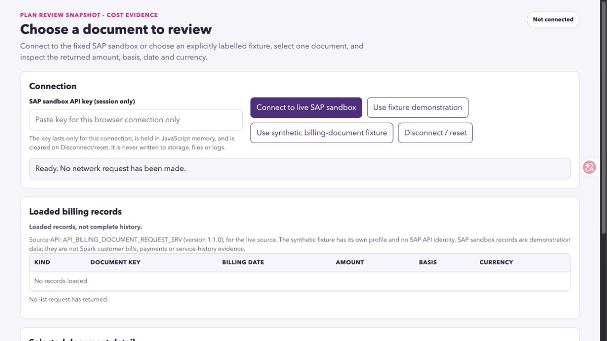

# Issue #10 acceptance: current source freeze and live workflow

16 October 2026 (Pacific/Auckland). [Issue #10](https://github.com/Francis-Lee-210/INFOSYS-A3/issues/10), primary AC25–26 of [parent #4](https://github.com/Francis-Lee-210/INFOSYS-A3/issues/4).

**PASS: inspected 17-file source package, fresh-directory startup, 167/167 fixture groups, 28/28 packaging cases, and a new actual SAP workflow including identical historical reopen and verified reset.** Actual [OpenCode development](../development/issue-27-opencode.md) is recorded separately from this independent acceptance.

PR #29/#30 were merged earlier by another maintainer. Issue #10 remains CLOSED after #30; follow-up [PR #32](https://github.com/Francis-Lee-210/INFOSYS-A3/pull/32) is the code-delivery review gate. Revert PR #31 is CLOSED and unmerged. The primary agent did not change main or branch protection.

## Tested source and package identity

| Coordinate | Verified value |
|---|---|
| Merged base | `203b200fd81cde6c49cb52d5be0afc5f1e4b89b5` — #30 merged `2026-10-16T03:20:30Z`, incorporating #29 merge `d4dc8a4b02eca5d5dc30955e93a004d3cfbc5b51` at `2026-10-16T03:06:26Z` |
| Reviewed teammate change | `ee514313fb736d0fd2a8878247a619b85768303f` — retain session write-attempt knowledge; allow no-known-data/no-write reset to finish while storage stays unreadable |
| Current reviewed repair | `463e409f6174e66b3438cad7a756b4bd24e96853` — preserve old bytes discovered after failed deletion; never promote this session's unverified write to Saved; Standards and Spec each close the same P2; [review record](issue-27-acceptance.md#independent-pr-32-review-and-current-source-freeze--16-october-2026) |
| Branch / source freeze | `codex/receipt-recovery-source-sync` / `463e409f6174e66b3438cad7a756b4bd24e96853` |
| Archive | `plan-review-snapshot-billing-lite-463e409.zip`, **100344 bytes**, 17 payload files |
| SHA-256 | `2ee02b2e46799907d086ad87037127a75ccf2286a8c9a2d8a0eba85fb4caff80` |
| Packaged at | `2026-10-16T09:16:29.775Z` |
| Post-run byte verification | `2026-10-16T09:25:50.433521+00:00` / `2026-10-16T22:25:50.433521+13:00` |
| Actual live workflow | `2026-10-16T09:20:39.330Z`–`2026-10-16T09:22:31.550Z` |
| Runtime | macOS 15.7.5, Node v26.0.0, Playwright 1.62.1, Chromium 151.0.7922.34 |
| Identity evidence | [Source-package manifest and independent inspection](issue-10-source-package.json) |
| Run evidence | [Independent-run metadata](issue-10-independent-run.json), [28-case packaging output](issue-10-package-test-results.txt), [167-group browser output](issue-10-browser-test-results.txt), [sanitized actual live checks](issue-10-live-evidence.json) |

Both packaging allowlists include `app/tests/issue-27.mjs`. This new freeze includes teammate `ee51431` and reviewed repair `463e409`; all 17 archived payload files remain unchanged by subsequent evidence-only commits. The previous 17-file `093f5f0` / 161-group acceptance is retained at [f6281c9](https://github.com/Francis-Lee-210/INFOSYS-A3/blob/f6281c9a99d61c5bb87a8c712e8cff070fb4b1be/docs/validation/issue-10-acceptance.md). The original 16-file `c9914cc` acceptance remains at [2dc5ce4](https://github.com/Francis-Lee-210/INFOSYS-A3/blob/2dc5ce4dfc8c10c0489f5521d10341cb9df65fe4/docs/validation/issue-10-acceptance.md). Neither old result certifies this new payload.

## Independent run and artifact inspection

1. Extracted the final ZIP into new `/private/tmp/a3-issue10-clean-463e409`. Independently checked CRC, exactly 17 regular files, every manifest length/SHA-256, and equality to frozen Git blobs and extracted bytes. No Git metadata or installed dependencies were present initially.
2. Followed [README-SOURCE](../../README-SOURCE.md): extracted `app/`, `PORT=6291 npm start`, correct empty initial screen/h1/title at `2026-10-16T09:19:58.317Z`, **before npm installation**. No runtime dependencies or build step; only a free loopback port was selected.
3. `npm ci` and `npx playwright install chromium` both exit 0 in the fresh extraction; its package-local Playwright 1.62.1 and managed Chromium were used.
4. `PORT=8800 npm test`, with filter/capture/external-module/browser/Chrome overrides unset: **167/167 PASS, exit 0**. All 146 inherited groups plus 21 Issue #27 groups passed, including current reset/history regressions, exact persistence/schema, keyboard journey and controlled failures. The harness closed its owned servers.
5. `node tools/tests/package-source.mjs`: **28/28 PASS, exit 0**. Archive-attribute/substitution, commit mode, symlink, missing/dirty payload, credential-literal and output-collision checks pass. Syntax/diff checks pass. Rae's proposed general import-reference completeness guard remains separate pending work.
6. After tests/live, all 17 checkout and extracted files still match the frozen Git blobs and manifest; ZIP size/SHA-256 are unchanged. Explicit entries, source, manifest and shared evidence were inspected for credentials/raw records. Conservative scans are not universal secret detectors; screenshots show empty key/record state only.
7. Parent #4 remains **OPEN**, title/body/state exactly equal to the before snapshot. #10 stays CLOSED after original #30. This follow-up does not certify whole-A3 delivery.
8. A separate read-only final record review found **no blocking discrepancy** in ZIP/manifest/frozen/current/extracted bytes, 167 PASS/28 ok output, live timestamps/counts/23 checks, historical evidence boundaries, 26 AC criteria and local links. It did not repeat tests/live or access the key/browser/GitHub; see [independent-run metadata](issue-10-independent-run.json).

## Actual SAP workflow from this extraction

The primary agent used the default adapter at `http://127.0.0.1:6291/` from this final ZIP. The existing signed-in SAP Business Accelerator Hub session supplied the key directly to the local password field. The key was never printed, copied to the clipboard, given to OpenCode or retained in evidence. Browser-control memory was reset after completion. No fixture or injected transport was used for this workflow.

- Actual `API_BILLING_DOCUMENT_REQUEST_SRV` v1.1.0 returned **10 loaded / 10 usable** records. Separate by-key detail matched the selected key/date/currency, and the same reported net/tax/gross amount strings continued through the review. Optional items completed with **partial** coverage and monetary reconciliation **unassessed**.
- Cost/decision screens preserved the selected evidence, original Live provenance, billing-request kind, date qualification and independent-amount meaning. Their `h1` and document titles matched each purpose.
- **Later** remained an intention, not a scheduled reminder. **Saved — receipt write and read-back verified** appeared. Reload preserved exact displayed evidence and receipt choice/identity, historical meaning and original Live provenance. The key input was empty; the new page session reported no automatic network request.
- Cancelling Reset preserved the same saved evidence/identity. Confirming Reset cleared receipt/reopen, key, connection and records. Another reload remained empty with correct initial heading/title.

[Live evidence](issue-10-live-evidence.json) contains only source/package identity, timestamps, counts, field names and booleans. Browser DOM scope does not expose `localStorage`: no direct live-storage inspection or raw live receipt export is claimed. Exact minimal schema/key exclusions are covered separately by the unchanged validator and packaged 167-group storage regressions. Historical B0 and injected results remain separate.

## Every Issue #10 criterion

| # | Required outcome | Result / evidence |
|---|---|---|
| 1 | Runnable source/adapter and runtime/network/key instructions, no keys/raw samples/unrelated output | PASS — inspected 17-file ZIP, matching manifest, self-contained README and fixed GET adapter. |
| 2 | Fresh extraction completes connection → selection → explanation → intent → save → reopen → reset | PASS — new dependency-free startup, full packaged suite and new actual live workflow. |
| 3 | Real selected-source workflow with local key and separate sanitized evidence | PASS — current actual SAP run; no fixture or historical B0 substitution. |
| 4 | Live label and historical original provenance, request/date/amount qualifications | PASS — exact evidence and provenance checked through all screens and reload. |
| 5 | Packaged fixture suite and explicit AC01–26 outcomes | PASS — 167/167 from this ZIP and all 26 criteria mapped below. Old #10 closure remains historical; new repair delivery awaits the follow-up PR. |
| 6 | Deliverable inspection and run/runtime/timestamp/source identity retained | PASS — new manifest, independent/live metadata, both complete test outputs and empty-state screenshots. |
| 7 | AC25/26 handoff and remaining A3 gates | PASS — this record/README; full assessment gates remain separate. |
| 8 | Preserve parent #4 OPEN and body/state | PASS — exact before/after comparison in independent-run JSON. |

## AC01–26 crosswalk

The scenarios and criteria are copied from the current parent contract. Stable per-criterion test identifiers are in the retained [#9 AC02–24 crosswalk](issue-9-acceptance.md#ac02ac24-combined-coverage). The inherited 146 groups and 21 Issue #27 groups all passed from this final ZIP. Controlled errors remain injected scenarios; no actual authentication/rate-limit/malformed-response incident is invented.

| AC | Scenario | Acceptance criterion | Outcome / evidence |
|---|---|---|---|
| AC01 | API validation | B0.1–B0.8 are resolved for one source, with specification/mapping, real non-empty list/detail reads and sanitized evidence from the intended transport. | PASS — historical [B0](issue-5-b0.md)/[frozen mapping](issue-5-field-contract.md) retained; no new B0 claim. |
| AC02 | Happy path | A user connects, selects a usable record, reads its explanation, chooses an intent, confirms, and sees a persisted receipt referring to exactly that record. | PASS — [167/167 packaged suite](issue-10-browser-test-results.txt); per-criterion scenarios/IDs retained in upstream #9 crosswalk. |
| AC03 | Provenance | Live sandbox, fixture and historical receipt states have distinct visible labels. No state claims to be a real Spark account. | PASS — [167/167 packaged suite](issue-10-browser-test-results.txt); per-criterion scenarios/IDs retained in upstream #9 crosswalk. |
| AC04 | Primary/alternate source | Both supported contract fixtures retain their document kind. The billing-request variant never becomes an issued or paid bill in the list, explanation or receipt. Only one source is active in a review. | PASS — [167/167 packaged suite](issue-10-browser-test-results.txt); per-criterion scenarios/IDs retained in upstream #9 crosswalk. |
| AC05 | Amount basis | A fixture with known net/tax/gross shows the expected signed decimal values and currency under correct labels. Neither the header-plus-items sum nor an annual-spend figure appears. | PASS — [167/167 packaged suite](issue-10-browser-test-results.txt); per-criterion scenarios/IDs retained in upstream #9 crosswalk. |
| AC06 | Missing fields | Missing optional party/tax/item/service-period data is labelled Unknown or Not available. Missing required amount/currency/date produces a contract error, not a zero-valued valid record. | PASS — [167/167 packaged suite](issue-10-browser-test-results.txt); per-criterion scenarios/IDs retained in upstream #9 crosswalk. |
| AC07 | Date meaning | The displayed date matches the mapped source date and meaning. A request's date is not labelled paid date; absent service-period data is not converted into month coverage. | PASS — [167/167 packaged suite](issue-10-browser-test-results.txt); per-criterion scenarios/IDs retained in upstream #9 crosswalk. |
| AC08 | Mixed currency | Selecting another currency shows that document's currency correctly. Cross-document or mixed-currency detail is not combined into one total or converted to NZD. | PASS — [167/167 packaged suite](issue-10-browser-test-results.txt); per-criterion scenarios/IDs retained in upstream #9 crosswalk. |
| AC09 | Partial data | A paginated fixture with a next link shows loaded/partial coverage; a next-page action remains on the validated source. Missing/partial items are not described as a complete breakdown. | PASS — [167/167 packaged suite](issue-10-browser-test-results.txt); per-criterion scenarios/IDs retained in upstream #9 crosswalk. |
| AC10 | Pagination safety | An invalid continuation or redirect cannot send the key outside the validated sandbox destination. The app shows a recoverable error and keeps the source boundary intact. | PASS — [167/167 packaged suite](issue-10-browser-test-results.txt); per-criterion scenarios/IDs retained in upstream #9 crosswalk. |
| AC11 | Empty response | A valid empty list shows No records and Retry/back options, creates no snapshot or receipt, and does not imply zero spend. | PASS — [167/167 packaged suite](issue-10-browser-test-results.txt); per-criterion scenarios/IDs retained in upstream #9 crosswalk. |
| AC12 | Authentication failure | A 401/403 fixture shows a connection/key action, not No records or fabricated data. Recovery does not persist or echo the credential. | PASS — [167/167 packaged suite](issue-10-browser-test-results.txt); per-criterion scenarios/IDs retained in upstream #9 crosswalk. |
| AC13 | Transient failures | Timeout/network, 429 and 5xx fixtures show distinguishable recoverable states. Retry is controlled, respects a supplied rate-limit delay, and cannot create duplicate receipts. | PASS — [167/167 packaged suite](issue-10-browser-test-results.txt); per-criterion scenarios/IDs retained in upstream #9 crosswalk. |
| AC14 | Invalid payload | Non-JSON or wrong-shape data, an invalid amount, and a key/detail mismatch are rejected as contract/data failures. No unrelated record is explained. | PASS — [167/167 packaged suite](issue-10-browser-test-results.txt); per-criterion scenarios/IDs retained in upstream #9 crosswalk. |
| AC15 | All four intents | Keep, Review options, Help and Later can each be confirmed for a valid snapshot; the receipt records the exact choice and intention-only meaning. | PASS — [167/167 packaged suite](issue-10-browser-test-results.txt); per-criterion scenarios/IDs retained in upstream #9 crosswalk. |
| AC16 | Inconsistent evidence | A material breakdown conflict is visible, does not replace a reported figure with a guessed total, and limits confirmation to Help/Later with the reason in the receipt. | PASS — [167/167 packaged suite](issue-10-browser-test-results.txt); per-criterion scenarios/IDs retained in upstream #9 crosswalk. |
| AC17 | Correct navigation | Back preserves appropriate reviewed context; choosing another document or refreshing clears an unconfirmed choice tied to the old snapshot. Late responses cannot restore the old selection. | PASS — [167/167 packaged suite](issue-10-browser-test-results.txt); per-criterion scenarios/IDs retained in upstream #9 crosswalk. |
| AC18 | Successful persistence | Saved is shown only after a write and valid read-back. Refresh reopens the same receipt, intent, original live/fixture provenance and historical evidence without a mandatory API call. | PASS — [167/167 packaged suite](issue-10-browser-test-results.txt); per-criterion scenarios/IDs retained in upstream #9 crosswalk. |
| AC19 | Save failure | An injected write/read-back failure keeps the decision visibly unsaved, retains the pending intent and permits Retry. A successful retry produces one valid receipt. | PASS — [167/167 packaged suite](issue-10-browser-test-results.txt); per-criterion scenarios/IDs retained in upstream #9 crosswalk. |
| AC20 | Duplicate confirmation | Repeated confirm/retry on the same review yields one receipt identity, not duplicate outcomes. | PASS — [167/167 packaged suite](issue-10-browser-test-results.txt); per-criterion scenarios/IDs retained in upstream #9 crosswalk. |
| AC21 | Invalid local state | Corrupt or unsupported-version receipt data produces an understandable recovery/reset path and no false saved history. | PASS — [167/167 packaged suite](issue-10-browser-test-results.txt); per-criterion scenarios/IDs retained in upstream #9 crosswalk. |
| AC22 | Reset | Cancelling reset preserves the receipt; confirming reset removes it, clears the key/review state and returns to Screen 1. | PASS — [167/167 packaged suite](issue-10-browser-test-results.txt); per-criterion scenarios/IDs retained in upstream #9 crosswalk. |
| AC23 | Data boundary | Browser storage, shared fixtures, logs, screenshots and package inspection show no API key or raw response dump. Only the specified minimal receipt is persisted. | PASS — packaged 167 exact-schema/storage/transport regressions plus final ZIP/manifest/source/shared-evidence inspection; actual live evidence is counts/booleans only, and screenshots show empty key/records. Direct live-storage inspection is not claimed. |
| AC24 | Accessibility and usability | The full journey is keyboard-operable with labelled controls, visible focus, announced loading/errors and clear Back/Continue/Confirm actions; no error traps the user. | PASS — [167/167 packaged suite](issue-10-browser-test-results.txt); per-criterion scenarios/IDs retained in upstream #9 crosswalk. |
| AC25 | Live workflow | With a locally supplied key, the packaged app completes the real selected-source flow and reopens its receipt. Record this separately from fixture test results. | PASS — [actual SAP evidence](issue-10-live-evidence.json): 10 usable, same-key detail, three-screen review, Later/save/read-back, identical historical reopen, cancel/confirm reset. |
| AC26 | Independent run | Source extracted in a clean directory runs from its instructions, uses the documented runtime/connection setup, and completes the core feature. Missing network/key prerequisites are explicit. | PASS — final ZIP extracted into a fresh directory, documented dependency-free startup, local test installation, full 167 suite and actual selected-source core flow; source/runtime/package identity recorded above. |

## Live workflow handoff and remaining gates

The new extracted package remains at <http://127.0.0.1:6291/> in reset state. To repeat, locally enter an authorised SAP key and retain the same origin/port/profile for historical reopen. [README](../../README-SOURCE.md) documents the workflow.

The package is pinned to `463e409`, 100,344 bytes with the SHA-256 above. All eight #10 criteria and AC01–26 have explicit PASS evidence for this payload. PR #32 remains the independent-review/code-delivery gate; old merged heads are not attributed these repairs. Rae's future import-reference guard is separate.

Whole-assessment gates remain: team/API-option rationale and model decisions, actual course MCP deployment, design/client evidence, presentation/recording/groupwork, pitch and authoritative Canvas receipts. Parent #4 stays OPEN. No PowerPoint/video, Signavio or Canvas action occurred.
