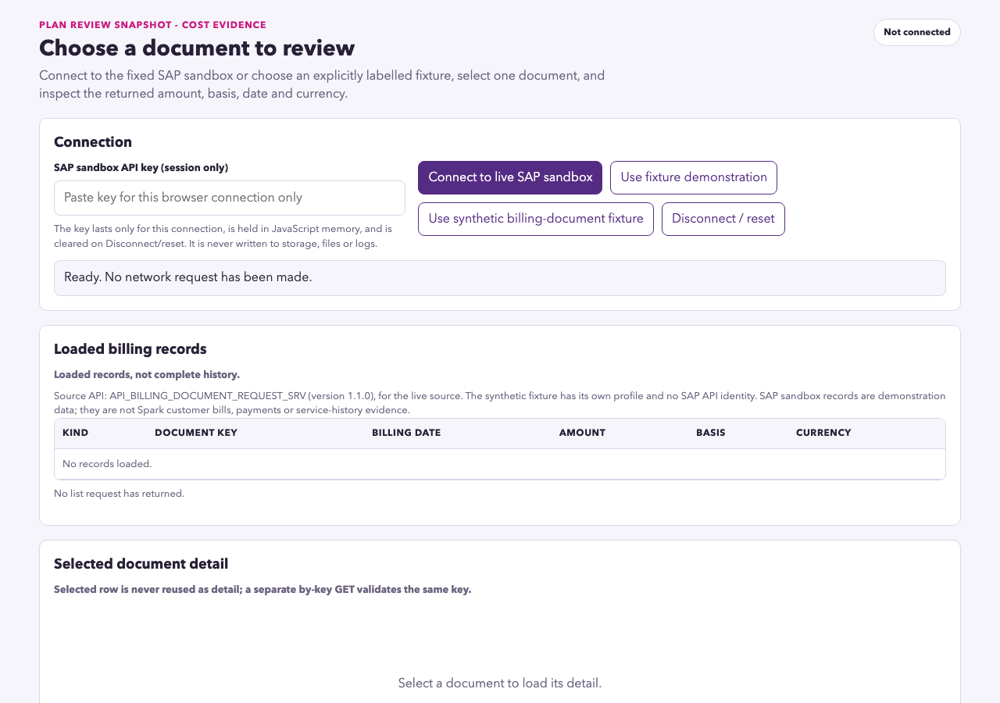

# Issue #10 acceptance: clean source handoff and live workflow gate

16 October 2026 (Pacific/Auckland). [Issue #10](https://github.com/Francis-Lee-210/INFOSYS-A3/issues/10), primary AC25–26 of [parent #4](https://github.com/Francis-Lee-210/INFOSYS-A3/issues/4).

**PASS: inspected source package, clean-directory independent run, 146/146 fixture groups, 28/28 packaging cases, and the actual selected-source workflow including historical reopen and reset. AC25/26 passed.** Issue #10 remains OPEN pending PR review/merge. [OpenCode development](../development/issue-10-opencode.md) is separate from the independent results here.

## Tested source and package identity

| Coordinate | Verified value |
|---|---|
| Dependency | PR #26 MERGED `f829c6c9f1107652e0affa9c894eca962e75662c`, `2026-10-15T23:07:02Z` (16 October 12:07:02 NZDT); #9 CLOSED |
| Branch / source freeze | `codex/issue-10-source-handoff` / `c9914cc4f1158fb46244ae7e5c03ec2b60ef6878` |
| Archive | `plan-review-snapshot-billing-lite-c9914cc.zip`, **92630 bytes**, 16 payload files |
| SHA-256 | `5ae2d5a14c806d8a76cd3de28e4828f29dc19a456db046ef9b770784cabaa7c7` |
| Packaged at | `2026-10-16T00:20:38.187Z` |
| Independent verification | `2026-10-16T00:27:21.635471+00:00` / `2026-10-16T13:27:21.635471+13:00` |
| Actual live workflow | `2026-10-16T00:37:15.667Z`–`2026-10-16T01:34:05.346Z`; completed 16 October 14:34:05 NZDT |
| Runtime | macOS 15.7.5, Node v26.0.0, Playwright 1.62.1, Chromium 151.0.7922.34 |
| Identity evidence | [Source-package manifest and independent ZIP inspection](issue-10-source-package.json) |
| Run evidence | [Independent-run metadata](issue-10-independent-run.json), [28-case packaging output](issue-10-package-test-results.txt), [146-group browser output](issue-10-browser-test-results.txt), [sanitized actual live checks](issue-10-live-evidence.json) |

The application runtime, fixtures and browser suite are byte-identical to the merged dependency. The source freeze adds a test lockfile, self-contained evaluator instructions and maintainer packaging controls. Subsequent evidence-only commits do not change these 16 archived payload files.

## Independent run and artifact inspection

1. Created `/private/tmp/a3-issue10-clean-c9914cc`, extracted the final ZIP with `unzip`, and independently checked CRC, the exact 16 regular payload entries, every manifest byte length/SHA-256, and equality to extracted bytes. No Git metadata or installed dependencies were present.
2. Followed [README-SOURCE](../../README-SOURCE.md): from extracted `app/`, `PORT=6289 npm start` started successfully **before any npm installation**, and the browser rendered the initial connection/list screen. The source has no runtime dependencies/build step. Only the documented free loopback port was selected.
3. Ran `npm ci` in that extracted `app/` (exit0; three packages installed), then `npx playwright install chromium` (exit0). Playwright was imported from this extraction's `node_modules`, using its managed Chromium. This was a fresh source directory on the current Mac.
4. Ran `PORT=7269 npm test`, with `TEST_FILTER`, both capture flags, external Playwright-module/browser-path and Chrome overrides unset: **146/146 groups PASS, exit0**. This includes the complete fixture keyboard journey, save/read-back, refresh/reopen, cancel/confirm reset, all four intents, stale responses, storage and controlled failures. The test servers were owned/closed by the harness.
5. Independently ran `node tools/tests/package-source.mjs` from the implementation checkout: **28/28 PASS, exit0**. It covers committed/info archive attributes, same-length substitutions, pinned old refs/symlinks, missing/dirty payload, quoted credential literals, decoy exclusions and exclusive output protection. Syntax and diff checks also passed.
6. Rechecked all 16 extracted payload hashes after npm/browser tests: unchanged. Inspected ZIP/manifest/shared test evidence and source; no bundled credential literal or raw OData response dump was found. The explicit allowlist excludes probes, response dumps, unrelated coursework, local configs, development history and dependency folders. Conservative scanning is not represented as a universal secret detector. No new screenshots of real records or raw responses were shared.
7. Re-read parent #4: title/body/state match the before-snapshot exactly, and state remains **OPEN**. #10 remains OPEN and assigned to Francis.
8. A separate read-only closure review checked the final live/independent records and this crosswalk: identity, timestamps, links and AC23/25/26 evidence boundaries were consistent, with no blocking finding. It did not read the key/browser or repeat the passing suites.

## Actual SAP workflow from the extracted package

The primary agent independently exercised the unchanged default adapter at `http://127.0.0.1:6289/`, running from the final ZIP extraction. An existing signed-in SAP Business Accelerator Hub session supplied the valid key directly to the local password field. The key was not printed, copied to the system clipboard, given to OpenCode, or written into evidence. No mock or injected transport was used for this flow.

- Live connect returned **10 loaded / 10 usable** records. A separate by-key detail read matched the selected key, signed amount and currency. The list retained its loaded/partial-history qualification. The only live source remained `API_BILLING_DOCUMENT_REQUEST_SRV` v1.1.0.
- The optional item read completed; the receipt reported **partial** coverage, with continuation not reported. SAP monetary reconciliation remained **unassessed**. No completeness, payment, service-history or Spark customer claim was introduced.
- Cost and decision screens retained the same document key, all available reported amount strings, currency and mapped date. Each retained the billing-request kind, original **Live SAP sandbox** provenance and the qualification that this is not a payment or service-coverage date. The cost screen kept independent reported amounts rather than summing/converting/annualising them.
- **Later** was confirmed as an intention only. The app displayed **Saved — receipt write and read-back verified.** After reload, the displayed receipt evidence, receipt identity and chosen intent matched exactly; the historical notice and original live provenance remained. The password field was empty and startup status reported no network request in the new page session.
- Cancelling reset retained the same saved receipt and intent. Confirming reset returned to Screen 1, cleared the visible key and records, removed the reopen action and showed **Not connected**. A further reload still had no receipt.

The retained [live evidence](issue-10-live-evidence.json) contains only source/package identity, timestamps, counts, schema field names and boolean checks. The browser control's read-only DOM scope does not expose `localStorage`; no direct live-storage inspection or exported live receipt is claimed. Exact minimal receipt fields and credential exclusions are covered separately by the unchanged validator and the packaged storage regressions. Historical B0, fixture/injected cases and this actual live run remain separate evidence.

## Every Issue #10 criterion

| # | Required outcome | Result / evidence |
|---|---|---|
| 1 | Runnable source, adapter and runtime/network/key instructions; no keys/raw samples/unrelated output | PASS — final 16-file ZIP, inspected manifest, self-contained README and unchanged fixed GET adapter. |
| 2 | Fresh extraction completes connection → selection → explanation → intent → save → refresh/reopen → reset | PASS — clean startup, full fixture suite and actual default-adapter live workflow above. |
| 3 | Real selected-source workflow with valid local key and separate sanitized evidence | PASS — actual current SAP run and separate count/boolean evidence; no fixture or historical B0 substitution. |
| 4 | Live review label and historical original provenance, with request/date/amount qualifications | PASS — same-key/amount/date/currency and live/historical labels verified through all three screens and reload. |
| 5 | Packaged fixture suite and AC01–26 explicit results; remain open if mandatory gates pending | PASS — 146/146 from extracted ZIP; all 26 criteria have explicit evidence below. Issue remains OPEN pending PR review/merge. |
| 6 | Inspect deliverable; retain run record/runtime/timestamps/final identity | PASS — manifest, independent-run/live records, both test outputs and neutral screenshots above. |
| 7 | Primary AC25/26 handoff and remaining A3 gates | PASS — this record, README, and concise handoff below; no course artifact/submission action. |
| 8 | Preserve parent #4 OPEN and body/state | PASS — exact before/after comparison recorded in independent-run JSON. |

## AC01–26 crosswalk

The scenarios and criteria are copied from the current parent contract. Stable per-criterion test identifiers are in the retained [#9 AC02–24 crosswalk](issue-9-acceptance.md#ac02ac24-combined-coverage). All corresponding unchanged tests passed from this final ZIP. Controlled errors remain injected scenarios; no actual authentication/rate-limit/malformed-response incident is invented.

| AC | Scenario | Acceptance criterion | Outcome / evidence |
|---|---|---|---|
| AC01 | API validation | B0.1–B0.8 are resolved for one source, with specification/mapping, real non-empty list/detail reads and sanitized evidence from the intended transport. | PASS — historical [B0](issue-5-b0.md)/[frozen mapping](issue-5-field-contract.md) retained; no new B0 claim. |
| AC02 | Happy path | A user connects, selects a usable record, reads its explanation, chooses an intent, confirms, and sees a persisted receipt referring to exactly that record. | PASS — [146/146 packaged suite](issue-10-browser-test-results.txt); per-criterion scenarios/IDs retained in upstream #9 crosswalk. |
| AC03 | Provenance | Live sandbox, fixture and historical receipt states have distinct visible labels. No state claims to be a real Spark account. | PASS — [146/146 packaged suite](issue-10-browser-test-results.txt); per-criterion scenarios/IDs retained in upstream #9 crosswalk. |
| AC04 | Primary/alternate source | Both supported contract fixtures retain their document kind. The billing-request variant never becomes an issued or paid bill in the list, explanation or receipt. Only one source is active in a review. | PASS — [146/146 packaged suite](issue-10-browser-test-results.txt); per-criterion scenarios/IDs retained in upstream #9 crosswalk. |
| AC05 | Amount basis | A fixture with known net/tax/gross shows the expected signed decimal values and currency under correct labels. Neither the header-plus-items sum nor an annual-spend figure appears. | PASS — [146/146 packaged suite](issue-10-browser-test-results.txt); per-criterion scenarios/IDs retained in upstream #9 crosswalk. |
| AC06 | Missing fields | Missing optional party/tax/item/service-period data is labelled Unknown or Not available. Missing required amount/currency/date produces a contract error, not a zero-valued valid record. | PASS — [146/146 packaged suite](issue-10-browser-test-results.txt); per-criterion scenarios/IDs retained in upstream #9 crosswalk. |
| AC07 | Date meaning | The displayed date matches the mapped source date and meaning. A request's date is not labelled paid date; absent service-period data is not converted into month coverage. | PASS — [146/146 packaged suite](issue-10-browser-test-results.txt); per-criterion scenarios/IDs retained in upstream #9 crosswalk. |
| AC08 | Mixed currency | Selecting another currency shows that document's currency correctly. Cross-document or mixed-currency detail is not combined into one total or converted to NZD. | PASS — [146/146 packaged suite](issue-10-browser-test-results.txt); per-criterion scenarios/IDs retained in upstream #9 crosswalk. |
| AC09 | Partial data | A paginated fixture with a next link shows loaded/partial coverage; a next-page action remains on the validated source. Missing/partial items are not described as a complete breakdown. | PASS — [146/146 packaged suite](issue-10-browser-test-results.txt); per-criterion scenarios/IDs retained in upstream #9 crosswalk. |
| AC10 | Pagination safety | An invalid continuation or redirect cannot send the key outside the validated sandbox destination. The app shows a recoverable error and keeps the source boundary intact. | PASS — [146/146 packaged suite](issue-10-browser-test-results.txt); per-criterion scenarios/IDs retained in upstream #9 crosswalk. |
| AC11 | Empty response | A valid empty list shows No records and Retry/back options, creates no snapshot or receipt, and does not imply zero spend. | PASS — [146/146 packaged suite](issue-10-browser-test-results.txt); per-criterion scenarios/IDs retained in upstream #9 crosswalk. |
| AC12 | Authentication failure | A 401/403 fixture shows a connection/key action, not No records or fabricated data. Recovery does not persist or echo the credential. | PASS — [146/146 packaged suite](issue-10-browser-test-results.txt); per-criterion scenarios/IDs retained in upstream #9 crosswalk. |
| AC13 | Transient failures | Timeout/network, 429 and 5xx fixtures show distinguishable recoverable states. Retry is controlled, respects a supplied rate-limit delay, and cannot create duplicate receipts. | PASS — [146/146 packaged suite](issue-10-browser-test-results.txt); per-criterion scenarios/IDs retained in upstream #9 crosswalk. |
| AC14 | Invalid payload | Non-JSON or wrong-shape data, an invalid amount, and a key/detail mismatch are rejected as contract/data failures. No unrelated record is explained. | PASS — [146/146 packaged suite](issue-10-browser-test-results.txt); per-criterion scenarios/IDs retained in upstream #9 crosswalk. |
| AC15 | All four intents | Keep, Review options, Help and Later can each be confirmed for a valid snapshot; the receipt records the exact choice and intention-only meaning. | PASS — [146/146 packaged suite](issue-10-browser-test-results.txt); per-criterion scenarios/IDs retained in upstream #9 crosswalk. |
| AC16 | Inconsistent evidence | A material breakdown conflict is visible, does not replace a reported figure with a guessed total, and limits confirmation to Help/Later with the reason in the receipt. | PASS — [146/146 packaged suite](issue-10-browser-test-results.txt); per-criterion scenarios/IDs retained in upstream #9 crosswalk. |
| AC17 | Correct navigation | Back preserves appropriate reviewed context; choosing another document or refreshing clears an unconfirmed choice tied to the old snapshot. Late responses cannot restore the old selection. | PASS — [146/146 packaged suite](issue-10-browser-test-results.txt); per-criterion scenarios/IDs retained in upstream #9 crosswalk. |
| AC18 | Successful persistence | Saved is shown only after a write and valid read-back. Refresh reopens the same receipt, intent, original live/fixture provenance and historical evidence without a mandatory API call. | PASS — [146/146 packaged suite](issue-10-browser-test-results.txt); per-criterion scenarios/IDs retained in upstream #9 crosswalk. |
| AC19 | Save failure | An injected write/read-back failure keeps the decision visibly unsaved, retains the pending intent and permits Retry. A successful retry produces one valid receipt. | PASS — [146/146 packaged suite](issue-10-browser-test-results.txt); per-criterion scenarios/IDs retained in upstream #9 crosswalk. |
| AC20 | Duplicate confirmation | Repeated confirm/retry on the same review yields one receipt identity, not duplicate outcomes. | PASS — [146/146 packaged suite](issue-10-browser-test-results.txt); per-criterion scenarios/IDs retained in upstream #9 crosswalk. |
| AC21 | Invalid local state | Corrupt or unsupported-version receipt data produces an understandable recovery/reset path and no false saved history. | PASS — [146/146 packaged suite](issue-10-browser-test-results.txt); per-criterion scenarios/IDs retained in upstream #9 crosswalk. |
| AC22 | Reset | Cancelling reset preserves the receipt; confirming reset removes it, clears the key/review state and returns to Screen 1. | PASS — [146/146 packaged suite](issue-10-browser-test-results.txt); per-criterion scenarios/IDs retained in upstream #9 crosswalk. |
| AC23 | Data boundary | Browser storage, shared fixtures, logs, screenshots and package inspection show no API key or raw response dump. Only the specified minimal receipt is persisted. | PASS — packaged146 exact-schema/storage/transport regressions plus final ZIP/manifest/source/shared-evidence inspection; actual live evidence is counts/booleans only, and screenshots show empty key/records. Direct live-storage inspection is not claimed. |
| AC24 | Accessibility and usability | The full journey is keyboard-operable with labelled controls, visible focus, announced loading/errors and clear Back/Continue/Confirm actions; no error traps the user. | PASS — [146/146 packaged suite](issue-10-browser-test-results.txt); per-criterion scenarios/IDs retained in upstream #9 crosswalk. |
| AC25 | Live workflow | With a locally supplied key, the packaged app completes the real selected-source flow and reopens its receipt. Record this separately from fixture test results. | PASS — [actual SAP evidence](issue-10-live-evidence.json): 10 usable, same-key detail, three-screen review, Later/save/read-back, identical historical reopen, cancel/confirm reset. |
| AC26 | Independent run | Source extracted in a clean directory runs from its instructions, uses the documented runtime/connection setup, and completes the core feature. Missing network/key prerequisites are explicit. | PASS — final ZIP extracted into a fresh directory, documented dependency-free startup, local test installation, full146 suite and actual selected-source core flow; source/runtime/package identity recorded above. |

## Live workflow handoff and remaining gates

The inspected extracted package remains available at <http://127.0.0.1:6289/> in its reset state. The complete actual flow has passed. To repeat it, obtain an authorised sandbox key from your SAP session and enter it locally in the password field. Keep the same origin/port/profile for historical reopen. The self-contained [README-SOURCE](../../README-SOURCE.md) documents runtime/network/key prerequisites and every control.

The archive remains pinned to source freeze `c9914cc`; subsequent evidence-only commits do not change its payload. AC01–26 and all eight #10 criteria pass; GitHub review/merge is the remaining code-delivery step. Parent #4 remains OPEN with its exact title/body/state preserved.

Whole-assessment gates remain separate: team/API-option rationale and model decisions, actual course MCP deployment, design/client evidence, presentation/recording/groupwork, pitch and authoritative Canvas receipts. Parent #4 stays OPEN. No PowerPoint/video creation, Signavio operation or Canvas submission occurred.
