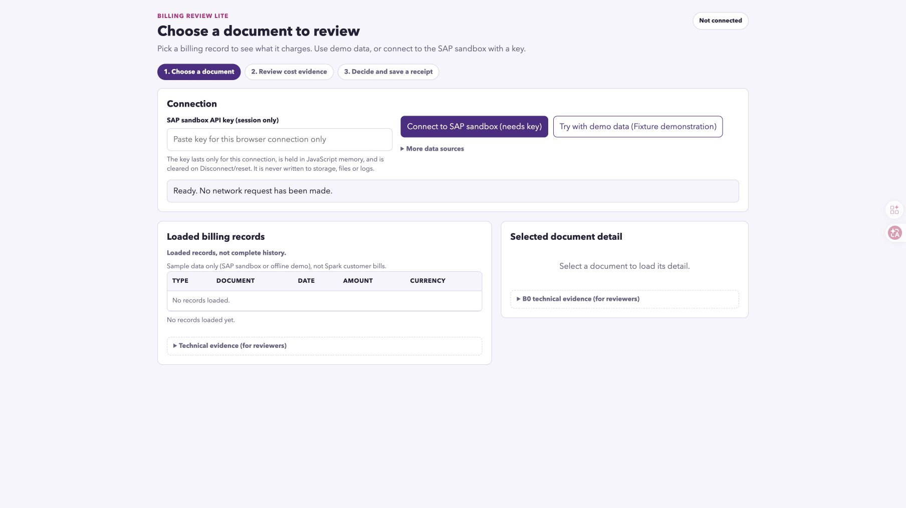

# Issue #4 final implementation acceptance

18 October 2026 (Pacific/Auckland). Final release checks for
[Issue #4](https://github.com/Francis-Lee-210/INFOSYS-A3/issues/4) and the
AC25–26 package/live-workflow handoff from
[Issue #10](https://github.com/Francis-Lee-210/INFOSYS-A3/issues/10).

**PASS: 63/63 packaging cases, 182/182 unfiltered packaged browser groups,
and 38/38 actual SAP browser observations.** The source ZIP was extracted into a
new directory, started before installing dependencies, and used for both the
browser suite and the actual SAP workflow. All 17 payload files still matched
the frozen Git blobs after these runs. No application source changed during
this acceptance. This independent record is separate from actual OpenCode
development records.

## Frozen source and archive

| Coordinate | Verified value |
|---|---|
| Current `main` source freeze | `7c574edd8514c33dce60df2bdcf6e78f7a754ab7` |
| Source tree | `4ccb6ecc4aa9e45306f86f024721478155c34c95` |
| Included release changes | Merged #40/#41 UI changes and #42 packaging fix; #35/#38 add documentation |
| Archive | `plan-review-snapshot-billing-lite-7c574ed.zip` |
| Size / payload | **108,949 bytes / 17 regular files** |
| ZIP SHA-256 | `300707045221bca287682d6223d1946be06b13336c7131f1bf12c2529a0f8f8f` |
| Packaged at | `2026-10-18T09:09:08.831Z` |
| Post-run byte verification | `2026-10-18T09:29:20.375890+00:00` |
| Runtime | macOS 15.7.5 arm64, Node v26.0.0, npm 11.12.1, Playwright 1.62.1, Chromium 151.0.7922.34 |
| Manifest | [Exact generated sidecar](issue-4-final-source-package.manifest.json) |
| Run metadata | [Inspection, startup, suites, live observations and cleanup](issue-4-final-evidence.json) |

`main` was re-read after execution and still resolved to this source freeze.
Later evidence-only commits do not change the source identity of this ZIP.
The previous `463e409` package and its 167/28 test counts remain historical at
[evidence commit 557ff2b](https://github.com/Francis-Lee-210/INFOSYS-A3/blob/557ff2b20297d965ea32926ee17fefcc740b598e/docs/validation/issue-10-acceptance.md).

To reproduce the archive from a checkout containing the frozen commit:

```sh
node tools/package-source.mjs --ref 7c574edd8514c33dce60df2bdcf6e78f7a754ab7 --output-dir release
```

The generated sidecar is outside the ZIP. A new build can have a different ZIP
hash because its packaging timestamp differs; compare its payload to the
manifest, and use the recorded hash to identify this particular artifact.

## Clean-directory run and automated checks

1. Independently inspected the archive with Python `zipfile`: valid CRC, exactly
   the 17 manifest entries, no symlinks or path traversal, every byte equal to
   the manifest and frozen Git blob. Initial extraction contained neither Git
   metadata nor installed dependencies.
2. Followed [README-SOURCE](../../README-SOURCE.md) from the extracted `app/`:
   `PORT=6317 npm start` returned HTTP 200 with the initial heading
   **Choose a document to review**, before `npm ci`. No build step or runtime
   dependency installation was required. TLS certificate verification remained
   enabled.
3. From this extraction, `npm ci`, `npm run check` and
   `npx playwright install chromium` exited 0. `PORT=44000 npm test` then passed
   **182/182**, exit 0, with all filter, capture, external Playwright/browser and
   Chrome overrides removed and no SAP key in the test process environment.
   [Complete browser output](issue-4-final-browser-test-results.txt).
4. On the frozen source, `node tools/tests/package-source.mjs` passed
   **63/63**, exit 0, with no skipped cases. This includes import-reference
   completeness, credential/raw-response rejection, symlink/dirty/missing
   payload checks, exclusive outputs and the Windows line-ending regressions.
   [Complete packaging output](issue-4-final-package-test-results.txt).
   Its temporary fixture commits and archive names are test cases; the final
   delivered archive is identified by the sidecar above.
5. After automated tests and the actual live workflow, all 17 worktree,
   archived and extracted payload files still matched the frozen Git blobs and
   manifest. Archive size/hash and both test-log hashes were rechecked.
6. The owned live server was stopped and port 6317 verified closed. The two
   owned browser tabs were closed and browser-control runtime reset after the
   application had been reset. Existing user tabs and other local servers
   were left in place.

**Coverage boundary:** these 182 groups use fixtures/injected failures. The 167
inherited regressions retain the documented legacy-expanded disclosure harness;
the 15 Issue #36 groups cover the shipped UI defaults. The new defaults include
keyboard disclosure/source/recovery checks. The actual SAP observations below
use the default packaged UI and adapter, independently of that harness. No
actual authentication, rate-limit or malformed-response incident is claimed.

## Actual SAP workflow from this ZIP

The default packaged GET adapter at `http://127.0.0.1:6317` used
`API_BILLING_DOCUMENT_REQUEST_SRV` v1.1.0. An authorised key from the signed-in
SAP Hub was entered only in the local password field. No fixture transport or
injected upstream response was used for this workflow. The selected-source
semantics remain governed by the earlier [B0 report](issue-5-b0.md) and
[field contract](issue-5-field-contract.md); this is a current-package workflow
rerun, not a new comparison of candidate APIs.

The retained observation window is `2026-10-18T09:15:32.735Z`–
`2026-10-18T09:24:36.589Z`. The start timestamp was recorded after the non-empty
list was visible, rather than at connection start.

| Step | Actual observation |
|---|---|
| List and selected detail | **10 loaded / 10 usable**; separate by-key detail matched the selected identifier, API date, currency and reported net amount |
| Optional items | **Partial**, one loaded row; no summed monetary result or claim of a complete breakdown |
| Cost evidence | Same selected request/date/currency and all three exact reported net/tax/gross strings; service period and payment remained unavailable; the date was not presented as payment or service coverage |
| Decision | **Later**, intention only, with no reminder claim; selected evidence and three amount strings retained |
| Save | **Saved — your receipt was stored and checked.** Visible receipt retained selected evidence, historical meaning and original Live source |
| Reload / reopen | Same displayed receipt identity, confirmation timestamp, intent, selected evidence, amounts and original Live provenance; key field rendered empty; UI reported no new network request |
| Cancel Reset | Same receipt identity/timestamp and Saved state retained |
| Confirm Reset, then reload | Receipt/reopen state, key, connection and loaded records cleared; next reload remained at the empty initial screen |

All **38/38** recorded boolean checks passed. Exact identifiers, timestamps and
amount strings were compared in transient browser-control memory; their values
are excluded from shared evidence. The retained
[sanitized live observations](issue-4-final-evidence.json) contain only package
identity, public API/version, counts, booleans and observation timestamps.

**Evidence limits:** live observations used visible UI/accessibility output.
There was no direct live-storage inspection, raw receipt export or network
interceptor. The no-new-request result describes what the UI reported. Exact
receipt schema, write/read-back verification and key exclusion are separately
covered by the packaged storage/transport regressions. The captured screenshot
shows the final empty state, not the pre-install startup.



## AC01–26 crosswalk

The criterion wording below is copied from Issue #4's current acceptance
matrix. Stable inherited test identifiers remain in the
[Issue #9 AC02–24 mapping](issue-9-acceptance.md#ac02ac24-combined-coverage);
the full fresh-package output above records their execution on this payload.
Current default-UI and heuristic changes are documented in
[Issue #36](issue-36-acceptance.md). That expert inspection records observations
and corrections; no participant test or measured customer outcome is claimed.

| AC | Scenario | Acceptance criterion | Outcome / evidence |
|---|---|---|---|
| AC01 | API validation | B0.1–B0.8 are resolved for one source, with specification/mapping, real non-empty list/detail reads and sanitized evidence from the intended transport. | PASS — earlier B0/mapping for the selected source, plus the new real non-empty list/by-key workflow; fixture results do not substitute for B0. |
| AC02 | Happy path | A user connects, selects a usable record, reads its explanation, chooses an intent, confirms, and sees a persisted receipt referring to exactly that record. | PASS — 182-group fixture run plus actual same-record review, Later/save and historical reopen. |
| AC03 | Provenance | Live sandbox, fixture and historical receipt states have distinct visible labels. No state claims to be a real Spark account. | PASS — fixture provenance regressions and current live/historical UI observations; no Spark account claim. |
| AC04 | Primary/alternate source | Both supported contract fixtures retain their document kind. The billing-request variant never becomes an issued or paid bill in the list, explanation or receipt. Only one source is active in a review. | PASS — the complete 182-group packaged fixture/injected run; inherited per-criterion test IDs are mapped in Issue #9. See the full log and coverage boundary above. |
| AC05 | Amount basis | A fixture with known net/tax/gross shows the expected signed decimal values and currency under correct labels. Neither the header-plus-items sum nor an annual-spend figure appears. | PASS — exact-decimal fixture cases and live three-string continuity; no annual or header-plus-items total. |
| AC06 | Missing fields | Missing optional party/tax/item/service-period data is labelled Unknown or Not available. Missing required amount/currency/date produces a contract error, not a zero-valued valid record. | PASS — the complete 182-group packaged fixture/injected run; inherited per-criterion test IDs are mapped in Issue #9. See the full log and coverage boundary above. |
| AC07 | Date meaning | The displayed date matches the mapped source date and meaning. A request's date is not labelled paid date; absent service-period data is not converted into month coverage. | PASS — mapped-date regressions and actual request/date qualification through cost and receipt. |
| AC08 | Mixed currency | Selecting another currency shows that document's currency correctly. Cross-document or mixed-currency detail is not combined into one total or converted to NZD. | PASS — the complete 182-group packaged fixture/injected run; inherited per-criterion test IDs are mapped in Issue #9. See the full log and coverage boundary above. |
| AC09 | Partial data | A paginated fixture with a next link shows loaded/partial coverage; a next-page action remains on the validated source. Missing/partial items are not described as a complete breakdown. | PASS — injected pagination/item cases; actual items remained partial with one row, unassessed. |
| AC10 | Pagination safety | An invalid continuation or redirect cannot send the key outside the validated sandbox destination. The app shows a recoverable error and keeps the source boundary intact. | PASS — the complete 182-group packaged fixture/injected run; inherited per-criterion test IDs are mapped in Issue #9. See the full log and coverage boundary above. |
| AC11 | Empty response | A valid empty list shows No records and Retry/back options, creates no snapshot or receipt, and does not imply zero spend. | PASS — the complete 182-group packaged fixture/injected run; inherited per-criterion test IDs are mapped in Issue #9. See the full log and coverage boundary above. |
| AC12 | Authentication failure | A 401/403 fixture shows a connection/key action, not No records or fabricated data. Recovery does not persist or echo the credential. | PASS — the complete 182-group packaged fixture/injected run; inherited per-criterion test IDs are mapped in Issue #9. See the full log and coverage boundary above. |
| AC13 | Transient failures | Timeout/network, 429 and 5xx fixtures show distinguishable recoverable states. Retry is controlled, respects a supplied rate-limit delay, and cannot create duplicate receipts. | PASS — the complete 182-group packaged fixture/injected run; inherited per-criterion test IDs are mapped in Issue #9. See the full log and coverage boundary above. |
| AC14 | Invalid payload | Non-JSON or wrong-shape data, an invalid amount, and a key/detail mismatch are rejected as contract/data failures. No unrelated record is explained. | PASS — the complete 182-group packaged fixture/injected run; inherited per-criterion test IDs are mapped in Issue #9. See the full log and coverage boundary above. |
| AC15 | All four intents | Keep, Review options, Help and Later can each be confirmed for a valid snapshot; the receipt records the exact choice and intention-only meaning. | PASS — all four intents in fixtures; Later observed in the separate actual SAP workflow. |
| AC16 | Inconsistent evidence | A material breakdown conflict is visible, does not replace a reported figure with a guessed total, and limits confirmation to Help/Later with the reason in the receipt. | PASS — the complete 182-group packaged fixture/injected run; inherited per-criterion test IDs are mapped in Issue #9. See the full log and coverage boundary above. |
| AC17 | Correct navigation | Back preserves appropriate reviewed context; choosing another document or refreshing clears an unconfirmed choice tied to the old snapshot. Late responses cannot restore the old selection. | PASS — the complete 182-group packaged fixture/injected run; inherited per-criterion test IDs are mapped in Issue #9. See the full log and coverage boundary above. |
| AC18 | Successful persistence | Saved is shown only after a write and valid read-back. Refresh reopens the same receipt, intent, original live/fixture provenance and historical evidence without a mandatory API call. | PASS — exact persistence/read-back regressions; live Saved UI and same displayed receipt on reload. No direct live-storage inspection claimed. |
| AC19 | Save failure | An injected write/read-back failure keeps the decision visibly unsaved, retains the pending intent and permits Retry. A successful retry produces one valid receipt. | PASS — the complete 182-group packaged fixture/injected run; inherited per-criterion test IDs are mapped in Issue #9. See the full log and coverage boundary above. |
| AC20 | Duplicate confirmation | Repeated confirm/retry on the same review yields one receipt identity, not duplicate outcomes. | PASS — the complete 182-group packaged fixture/injected run; inherited per-criterion test IDs are mapped in Issue #9. See the full log and coverage boundary above. |
| AC21 | Invalid local state | Corrupt or unsupported-version receipt data produces an understandable recovery/reset path and no false saved history. | PASS — the complete 182-group packaged fixture/injected run; inherited per-criterion test IDs are mapped in Issue #9. See the full log and coverage boundary above. |
| AC22 | Reset | Cancelling reset preserves the receipt; confirming reset removes it, clears the key/review state and returns to Screen 1. | PASS — injected failure/reset regressions and actual cancel, confirm and empty subsequent reload. |
| AC23 | Data boundary | Browser storage, shared fixtures, logs, screenshots and package inspection show no API key or raw response dump. Only the specified minimal receipt is persisted. | PASS — packaged schema/storage/transport regressions, credential/raw-dump packaging guards and inspection of the exact 17-file archive and new shared evidence. Actual record/key values excluded; screenshot is the empty state. |
| AC24 | Accessibility and usability | The full journey is keyboard-operable with labelled controls, visible focus, announced loading/errors and clear Back/Continue/Confirm actions; no error traps the user. | PASS — inherited keyboard/focus/error tests plus current default-UI disclosure/source/recovery cases; earlier heuristic observations/corrections retained in #9/#36. |
| AC25 | Live workflow | With a locally supplied key, the packaged app completes the real selected-source flow and reopens its receipt. Record this separately from fixture test results. | PASS — separate actual packaged SAP flow, 10 usable records, same-key detail, cost/intent/save, identical displayed historical reopen and deliberate reset; 38/38 UI observations. |
| AC26 | Independent run | Source extracted in a clean directory runs from its instructions, uses the documented runtime/connection setup, and completes the core feature. Missing network/key prerequisites are explicit. | PASS — independent CRC/manifest/Git/extracted-byte inspection, dependency-free startup, fresh local test setup, full 182-group run and actual source workflow from that extraction. |

## Independent evidence audit

A separate native Codex subagent completed a read-only audit on 18 October:
**PASS, no blocking discrepancy.** It independently compared all 17 payload
files across frozen Git/worktree/manifest/ZIP/extraction, archive size/hash/CRC
and entry safety; counted the 63 packaging and 182 browser successes; matched
the 38 true live-observation flags and sanitized metadata; checked all 26
criterion cells verbatim, the 11 relative links/anchor, screenshot privacy and
historical #10 banner-only change. The reviewer used retained evidence and did
not rerun SAP/tests or access the key/browser state. Its conclusion is an
independent audit result; the underlying execution evidence remains linked
above. No unresolved implementation acceptance defect was found.

## Completion scope

The implementation gates in Issue #4 pass for the package identified above.
The old #10 record's instruction to keep #4 open applied to closing that child
on 16 October; the parent is eligible for completion only after this separate
current-main release gate and its evidence audit finish.

This acceptance does not certify the whole A3 assessment or a Canvas receipt.
Presentation/recording, the final usability walkthrough narrative, team
contributions, the course MCP exercise and submission artifacts retain their
own records and completion gates in #14–#17/#37. No new PowerPoint, video,
Signavio model, production deployment or Canvas submission was produced here.
