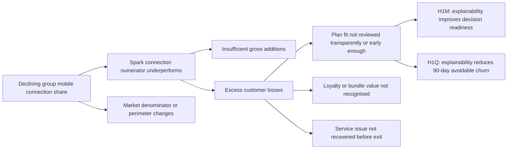
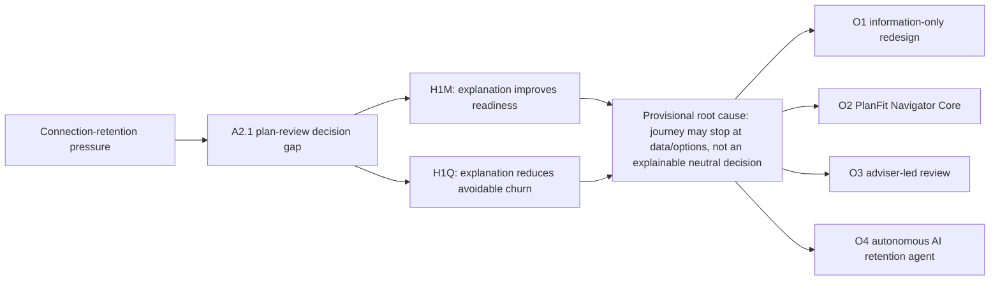

# A1-D2: Designing the analysis, gathering data, analysing data and interpreting results

**Student:** Francis Lee (tli174)  
**Client:** Spark New Zealand Limited  
**Problem domain:** Strategic / Competitive

## Executive analytical chain

Commerce Commission data show that Spark group mobile connection share fell from 42% in June 2022 to 38% in June 2025 (Commerce Commission, 2026, pp. 213-216). This is the strategic symptom examined in this report. The more recent FY26 results are mixed rather than uniformly negative. Mobile service revenue grew 1.1% to NZ$998 million, while IDC mobile service-revenue share was 41.0% and its annual decline slowed to 0.5 percentage points (Spark New Zealand Limited, 2026b, pp. 12-14). Because these measures concern revenue rather than connections, they neither extend the Commission's series nor provide a baseline for the selected plan-review process.

This report focuses on Spark's mobile plan-value review for individual consumers. Spark states that it has improved its website and MySpark app to make plans, products and account details easier to find. The regulator's transparency benchmark goes further: it calls for a longer usage and spending history, allowance comparisons, appropriate-plan prompts and a straightforward way to change plans. Spark's disclosures and public change-plan page do not show whether customers receive these elements as a timely and understandable fit or no-change conclusion (Commerce Commission, 2025, pp. 7-9; Spark New Zealand Limited, 2026a, pp. 4, 21; Spark New Zealand Limited, n.d.). The gap is in the public documentation; it does not prove that Spark's internal process is defective.

The analysis separates an interview-testable mechanism from a business outcome that requires a controlled pilot. H1M asks whether an explainable conclusion improves decision readiness when the underlying information is unchanged. H1Q asks whether that change can reduce 90-day avoidable churn by at least 15%. In Ryan Li's interview, readiness rose from 3/5 to 4/5 because the reasoning was visible and no change remained an option. This supports H1M for his case but cannot test H1Q. The proposed next step is a controlled **PlanFit Navigator Core** pilot with a rule-based fit or no-change conclusion, correction and human-help routes, and traceable outcome measurement.

## 1. Revised A1-D1 framing

### 1.1 Dysfunctional process and boundary

The process examined is Spark's New Zealand mobile plan-value review for individual pay-monthly and prepaid customers. The boundary starts when a customer notices a possible mismatch or chooses to review a plan. It ends once the customer has enough information to stay, change, defer, decline or exit. The process covers usage and spending information, plan comparison, digital or assisted support, and the customer's decision. It excludes network remediation, wholesale and MVNO operations, Skinny, enterprise and SME sales, unrelated device logistics, and internal eligibility or adviser rules that have not been disclosed.

> **Revised dysfunction:** The publicly documented customer-initiated journey does not demonstrate a consistent, timely and transparent plan-fit conclusion.

This definition keeps the strategic issue in view without guessing how Spark's internal workflow operates. Timing, cross-channel context, consistency of explanation and outcome feedback still require validation.

### 1.2 Revised SMART problem statement

> By 30 June 2027, validate through a controlled pilot whether improving the Spark-branded individual-consumer mobile plan-value review can reduce 90-day avoidable churn by at least 15%, achieve at least 60% review completion and at least 20% eligible-recommendation acceptance, without material deterioration in ARPU, contribution margin or customer trust.

**Table 1. SMART problem-statement test**

| SMART element | Justification |
|---|---|
| Specific | Defines the consumer plan-value review and controlled-pilot decision. |
| Measurable | Specifies a 15% churn reduction, 60% completion, 20% acceptance and named guardrails. |
| Achievable | Requires baseline, power and economics gates before launch rather than promising a market-wide outcome. |
| Relevant | Tests a controllable retention mechanism without claiming that one process determines group connection share. |
| Time-bound | Sets 30 June 2027 and a 90-day outcome window. |

These thresholds are decision gates proposed for the pilot. They are not Spark commitments or forecasts.

### 1.3 Revised issue tree and hypotheses

**Figure 1. Revised issue tree and selected A2.1 branch.** The top split follows `share = Spark connections / total measured connections`. A2.1 is the selected analytical focus, not a proven root cause.

**Table 2. Atomic hypotheses and falsification rules**

| ID | Atomic hypothesis | Falsification or decision rule |
|---|---|---|
| H1M | A consumer proxy rates decision readiness higher for an explainable fit conclusion than for the same usage/spend data plus unranked options. | Not supported for the case if B receives an equal/lower rating or no improvement is attributable to explanation. |
| H1Q | Among eligible starters assigned at the same time and channel, an explainable conclusion produces at least 15% lower 90-day avoidable churn than an equivalent-information comparator. | Continuation fails if adequately powered evidence is adverse/clearly below 15% or a material guardrail fails; an underpowered result is inconclusive. |
| H2 | Intervention before a validated at-risk milestone outperforms intervention after contact or port-out intent. | Comparable early treatment does not outperform late treatment. |
| H3 | Price/value is the largest valid recorded reason among voluntary prepaid losses. | Another valid reason is larger or missingness prevents inference. |
| H4 | Explicit loyalty recognition lifts eligible-offer acceptance by at least 10% versus an equivalent offer. | Lift is below 10% or the margin guardrail fails. |
| H5 | Customers repeating context across channels have completion at least 10 percentage points lower than customers whose context persists. | Adjusted gap is below 10 percentage points. |
| H6 | Plan-fit/value reasons exceed network/service reasons among validated avoidable-churn cases. | Plan-fit/value is not the larger valid category. |

### 1.4 Revised AS-IS

The revised AS-IS BPMN 2.0 model stays within the available evidence. It maps the documented customer-initiated digital and assisted journey, where usage, spending and plan options may be available without an explainable fit conclusion. The annotations separate this documentation gap from four hypotheses that still need internal evidence.

**Figure 2. Revised AS-IS Spark individual-consumer mobile plan-value review.** The BPMN model separates the Customer and Spark participants and shows the messages and decision routes between them. Evidence-status annotations make clear that this is an analytical model, not a Spark-validated internal process.

## 2. Major KPI and two sub-KPIs

Let `N_g` be eligible review starters assigned to group `g`; `C_g` valid avoidable voluntary churn events within 90 days; `R_s` started reviews; `R_c` reviews where the assigned output was displayed and recorded; `R_e` treatment reviews with a suitability-valid recommendation; and `R_a` treatment outcomes where that recommendation was explicitly accepted or successfully fulfilled.

**Table 3. Major KPI and two sub-KPIs**

| KPI | Formula and cohort | Proposed target | Source and owner | SMART rationale |
|---|---|---:|---|---|
| Major: ITT relative reduction in 90-day avoidable voluntary churn | `rate_g = C_g/N_g`; `(rate_control − rate_treatment)/rate_control` | ≥15% by 30 June 2027 | CRM, billing, eligibility, port/disconnect and assignment logs; retention/process owner | Measures the causal retention outcome for every assigned eligible starter. |
| Sub-KPI 1: recorded review-output completion | `R_c/R_s` | ≥60% by 30 June 2027 | MySpark and assisted-channel event records; digital product owner | Tests whether most starters reach a recorded, decision-useful output. |
| Sub-KPI 2: eligible-recommendation acceptance | `R_a/R_e` in the explainable arm | ≥20% by 30 June 2027 | Recommendation, response, eligibility and fulfilment records; mobile proposition owner | Counts only explicit no-change acceptance or successfully fulfilled eligible change. |

The comparator does not make a recommendation, so its plan-choice or no-change rate is diagnostic and should not be labelled as acceptance. The process owner must approve the avoidable-churn exclusions and reason codes. The guardrails cover ARPU and contribution margin, complaints, trust, privacy and security, and the correction or reversal of an unsuitable plan.

The four-point fall in connection share cannot serve as a process baseline. Spark must first instrument comparator churn (`B0`), current completion (`B1`) and treatment-equivalent acceptance (`B2`). The 15% churn threshold sets a material effect and remains subject to baseline, power and economic checks. A 60% completion floor limits the risk that results from completers are taken to represent the whole journey. The 20% acceptance target requires an explicit outcome for one in five suitability-valid recommendations while still treating no change as a valid success. All three thresholds need to be fixed before the results are reviewed.

## 3. Analysis work plan

Table 4 links each hypothesis to a test that could change the decision, then identifies the data, source and intended analytical output. This follows the work-plan structure in Lecture 4 (INFOSYS 704 Teaching Team, 2026a, slides 65-70).

**Table 4. Analysis work plan by hypothesis**

| Priority | Hypothesis and test | Required data | Source and collection | End product and decision |
|---:|---|---|---|---|
| 1 | H1M: matched Output A/B interview with neutral probes | Order, 1-5 readiness, comprehension, trust, concerns | Authentic Ryan Li interview; GenAI as analytical challenger | Case evidence matrix and H1M verdict |
| 2 | H1Q: controlled pilot; matched observational fallback | Assignment, eligibility, exposure, completion, acceptance, churn, guardrails | Authorised MySpark, CRM, billing and port/disconnect records | ITT effect and interval; stop, redesign or capped continuation |
| 3 | H2: early-versus-late event-time comparison | Trigger, treatment, contact, port and churn timestamps | Campaign, CRM, contact and port logs | Timing curve and separate timing-module decision |
| 4 | H3/H6: reason Pareto and competing-cause comparison | Standardised exit reasons, missingness, service events | CRM, exit survey, complaints and network records | Branch priority with an explicit unknown category |
| 5 | H4: equivalent-offer framing test | Eligibility, loyalty treatment, acceptance and margin | Offer, CRM and finance records | Acceptance lift with margin guardrail |
| 6 | H5: cross-channel funnel/regression | Journey ID, transfers, repeated context/authentication, completion | MySpark, contact-centre and retail records | Adjusted completion-gap estimate |

The required interview can address H1M now, which is why it comes first. H1Q follows as the quantitative test that links the proposed mechanism to the major KPI. Timing, loyalty and channel continuity remain outside the H1Q treatment; including them would make the explanation effect difficult to isolate.

## 4. Data gathering and analysis plan for selected H1M and future H1Q

### 4.1 Matched design and required data

Both fictional outputs use the same inputs: a current plan of $60 per month for 12 GB, recent usage of 7.8, 8.4 and 9.1 GB, Plan X at $55 for 10 GB, the current plan at $60 for 12 GB, and Plan Y at $65 for 20 GB. Output A presents this information as three unranked options. Output B keeps the information unchanged but adds a cautious conclusion. It shows the $5 saving and the 0.9 GB buffer above the highest observed usage, warns that headroom would fall, and offers no-change, correction and human-help routes. Appendix D contains both stimuli. The participant rates readiness on the same 1-5 scale after each output and explains the rating. Presentation order, stimulus version and any order effect are recorded.

**Table 5. Data requirements and integrity controls**

| Stage | Data | Source and collection | Integrity controls |
|---|---|---|---|
| H1M | Ratings, explanation, trust, uncertainty, order effect, prior review context | Ryan Li interview, 21 August 2026, in person; GenAI transcript as a non-customer challenge | Consent and metadata recorded; no account identifiers; verbatim trace to S1-S10 |
| H1Q | Eligibility/assignment, plan and value bands, approved inputs, journey events, recommendation/fulfilment, 90-day churn and guardrails | Randomised treatment/control pilot after required approvals; matched cohort only as fallback | Pre-register assignment, metrics and exclusions; least privilege; completeness and contamination checks |
| Context | Market share, strategy and transparency rationale | Official Commission and Spark documents | External context only; never internal root-cause evidence |

The data design applies the Privacy Act principles of a necessary purpose, transparent collection, reasonable security, accuracy before use and limits on later use (Office of the Privacy Commissioner, n.d.). This is a design requirement rather than legal advice. Spark would still need approval from its privacy, legal, product and security owners.

### 4.2 Analysis and visualisation

Analysis of Ryan Li's transcript involved familiarisation, open coding, theme development, a search for disconfirming evidence and a final traceability check (Braun & Clarke, 2006). The within-case result is `readiness_B − readiness_A = +1`. It is interpreted alongside Ryan's explanation and is not treated as a population estimate. The H1Q pilot would use intention-to-treat, so non-completers stay in their assigned denominator. Reporting would cover absolute and relative churn differences with a confidence interval, together with checks for balance, exposure, missingness, contamination, segment effects and 90-day censoring. Regression would test the robustness of the primary comparison, not replace it.

For H1M, the planned displays are a paired A/B readiness chart with quotation locators and an evidence matrix linking rating, comprehension and trust to the verdict. H1Q would use a treatment-control churn estimate with a 95% interval and a review funnel with labelled denominators. A segment forest plot would show heterogeneity, while a reason-code Pareto would retain "unknown". Each display answers a defined analytical question.

## 5. Semi-structured interview guide

The guide has ten sections. Each starts with a neutral question, followed by optional probes where more detail is needed. The final question gives the participant a chance to challenge the framing or add something that the guide missed. This structure follows Lecture 5 (INFOSYS 704 Teaching Team, 2026b, slides 11-16).

**Table 6. Semi-structured interview guide**

| Section | Core neutral question | Optional probes | Link |
|---:|---|---|---|
| 1. Opening/context | What mobile-plan experience are you comfortable discussing? | customer type; privacy; useful outcome | Context |
| 2. Review trigger | Describe the last time you considered whether a plan still suited you. | bill, usage, budget, competitor, service, timing | H2/D2 |
| 3. Journey | What did you do from trigger to decision or deferral? | sequence, channels, time, outcome | AS-IS |
| 4. Usage/spend | What information did you see and how did you interpret it? | period, allowance, spend, uncertainty | H1M/H1Q |
| 5. Comparison | How did you compare the current plan and alternatives? | like-for-like cost, eligibility, no-change | H1M/H3 |
| 6. Hand-offs | Across channels, what carried over and what did you repeat? | authentication, context, consistency | H5 |
| 7. Trust | What would you need before trusting a recommendation? | reasoning, trade-offs, provider benefit, correction | H1M/H6 |
| 8. Timing/consent | When would a prompt be useful, intrusive or too late? | trigger, frequency, opt-out, channel | H2 |
| 9. Loyalty/concept | How should loyalty affect the decision? Rate A/B separately and explain. | order effect, no-change, uncertainty, help | H1M/H4 |
| 10. Close | Which one change would most improve the journey? What is missing? | prioritise; seek contradiction | All |

Francis interviewed Ryan Li in person on 21 August 2026 between 10:00 and 12:00. Ryan completed the response document himself and consented to notes, recording and the use of his name. The interview did not use a Google Form. Appendix A contains the full record.

## 6. Interview analysis and hypothesis verdict

Ryan Li participated as a group member and consumer proxy with pay-monthly app and chat experience. The GenAI response serves a different purpose: it challenges the analysis but cannot provide lived experience or evidence about Spark's systems. Both interviews followed the same ten-section guide. Ryan saw Output A before B, while the GenAI respondent saw B before A, which makes a possible order effect visible. Appendices A and B contain the full transcripts.

**Table 7. Cross-source interview evidence matrix**

| Theme | Ryan Li, authentic A→B | GenAI challenger, B→A | Analytical implication |
|---|---|---|---|
| Data-to-decision gap | A 3/5; B 4/5. The $5 saving, 0.9 GB buffer, growth warning and reasoning clarified the trade-off (S4, S9). | A 2/5; B 4/5. Explanation is inspectable but unsafe if inputs are wrong. | H1M is supported for Ryan's case; population effect remains unknown. |
| Conditional trust | Requires period, total cost, saving, buffer, exclusions, no-change and human help (S7). | Requires uncertainty, correction, versioning and suitability monitoring. | Optimise comprehension and suitability, not acceptance alone. |
| Timing | Prompts could help after unusual bills, before renewal or persistent under-use; porting is too late (S8). | Requires purpose, preference, frequency cap and an independent H2 test. | Do not bundle timing into H1Q treatment. |
| Channel continuity | Login carried, but the review reason and considered options did not (S6). | Requires measurement before generalisation. | D3/H5 is supported for one journey only. |
| Competing causes | Coverage or service quality could outweigh a small saving (S10). | Requires a valid reason taxonomy. | H3/H6 remain credible alternatives. |
| Order effect | Seeing A first exposed missing interpretation; only one human order was tested. | Seeing B first could make A appear incomplete. | The single human comparison is exploratory. |

Ryan's account narrows the public-documentation finding, but it does not establish an internal defect. A higher bill and a competitor promotion prompted him to check value before he intended to leave (S2). Online chat gave him links rather than a clear answer about plan fit (S3), and he had to repeat the context when he changed channels (S6). His experience therefore supports D3 for this journey. It does not resolve D4 on explanation consistency or D5 on outcome feedback. The case fits the provisional options-without-conclusion mechanism, but one journey cannot establish a Spark-wide root cause.

> **Verdict:** H1M is supported for this exploratory case (`n = 1`): Ryan moved from A 3/5 to B 4/5 and attributed the gain to visible reasoning and a no-change option. H1Q is not tested.

For a future participant, H1M would not be supported if B receives no higher rating than A or if the participant cannot explain how the added conclusion helped. In that case, the data plan would shift first to H2 timing. The PlanFit explanation would need to be redesigned or removed unless other evidence justified it. Mixed findings would remain inconclusive and support only a small exploratory test. This rule keeps the preferred solution open to rejection.

## 7. Solution tree and selected pathway

**Figure 3. Solution Tree from problem to pathways.** H1M and H1Q test the perception mechanism and causal outcome under the same issue; the root cause remains provisional.

**Table 8. Weighted pathway assessment**

| Criterion | Weight | O1 | O2 | O3 | O4 |
|---|---:|---:|---:|---:|---:|
| Major-KPI impact | 25% | 3 | 5 | 4 | 5 |
| Evidence/causal fit | 20% | 4 | 4 | 3 | 3 |
| Process coverage | 15% | 3 | 5 | 3 | 4 |
| Feasibility | 10% | 5 | 4 | 3 | 2 |
| Cost/time to pilot | 10% | 5 | 3 | 2 | 1 |
| Trust/privacy/adoption | 10% | 5 | 4 | 3 | 2 |
| Measurement/prototype fit | 10% | 4 | 5 | 3 | 4 |
| **Weighted score / 5** | **100%** | **3.90** | **4.40** | **3.15** | **3.35** |

The scores are consulting judgements rather than measured Spark costs or feasibility results. PlanFit Navigator Core ranks highest because it changes what the process gives the customer: a neutral and explainable decision instead of information alone. The design uses rule-based calculation, rechecks eligibility and records the version shown to the customer. Routine cases can stay in self-service, while exceptions move to human support. It also provides a clean comparator for H1Q. These changes apply Rosemann's output, activity/control and role-allocation levers (Rosemann, 2001; INFOSYS 704 Teaching Team, 2026c). Compared with the other options, PlanFit addresses the proposed gap without the operating cost of adviser-led review or the persuasion, privacy and suitability risks of an autonomous AI retention agent.

## 8. Proposed TO-BE process

PlanFit Navigator Core uses only approved plan, usage and spending inputs. After random assignment, both arms follow the same eligibility and suitability rules. The comparator receives the information, while the treatment arm also receives an explainable fit or no-change conclusion. That explanation shows the data period, calculation, cost and allowance trade-offs, and any uncertainty. The customer can correct the inputs, keep or change the plan, ask for help, defer, or exit. Spark rechecks eligibility and terms before fulfilment. Versioned records of assignment, display, decision and fulfilment keep every assigned case in the 90-day analysis, including non-completers.

**Figure 4. PlanFit Navigator Core TO-BE BPMN 2.0 process.** The Optimised v2 model separates the Customer and Spark participants and groups Spark's work into four lanes. Four message exchanges keep the main decision cycle readable. Three linked subprocesses contain output generation, detailed response resolution and fulfilment; a separate timer-start process measures 90-day outcomes.

The model records `N_g/R_s` when eligibility and assignment occur. It counts `R_c` only after the assigned output has been displayed and recorded. It counts `R_a` only when the customer explicitly accepts a suitability-valid no-change recommendation or Spark successfully fulfils an eligible recommended change. Choices in the comparator arm remain diagnostic. The conclusion and explanation are the only treatment differences; timing, loyalty and broader channel continuity stay outside this experiment. Human support, data correction, revalidation and guardrails stop the process from optimising acceptance at the expense of suitability.

The GenAI exchange was used to test the process design, especially its sequence, exceptions and measurement controls. It suggested separating participants and Spark lanes, matching every sent message with a catch, preserving valid no-change and correction routes, and starting measurement on a timer. The exchange also helped identify possible deadlocks, persuasive design and unsupported reuse of customer data. Appendix C contains the full record. These suggestions informed the model but do not count as Spark or customer evidence.

## 9. Recommended solution and implementation

**Situation.** SPK-30 centres Spark's competitive direction on mobile and core connectivity, supported by better network and customer experiences. In FY26, mobile service revenue grew 1.1%, Consumer and SME interaction NPS increased by two points to +42, and Spark reported improvements to its digital journeys (Spark New Zealand Limited, 2026a, pp. 4-5, 10-11, 21). Against that broader improvement, the selected process is a specific opportunity. It is not evidence of a general customer-experience failure.

**Complication.** The Commission's connection-share trend indicates historical strategic pressure, but public sources cannot identify its internal process cause. Ryan's interview supports the explanation mechanism for one participant. The business KPI, baselines and economics have not yet been tested.

**Question.** How can Spark test whether a clearer consumer plan decision reduces avoidable loss without indiscriminate discounting or claiming that one journey controls market share?

**Answer.** Pilot PlanFit Navigator Core as a small, controlled change. The treatment adds a neutral, explainable fit or no-change conclusion to information that is otherwise equivalent to the comparator. The pilot keeps correction and human support available and follows every assignment for 90 days. Spark should stop, redesign or permit only a capped continuation after reviewing the causal result, data integrity, guardrails and economics.

Implementation starts with the difference between information and an auditable decision. Spark already has a public plan catalogue; the proposed gap is the customer's ability to interpret it and reach a defensible outcome. Keeping the current plan must count as success when suitable, otherwise the review becomes an upsell mechanism. Measurement must also be built in because no verified internal baseline has been supplied.

The roadmap groups six workstreams into four governance phases. Mechanism research and AS-IS validation come before design, a controlled build, pilot execution and the 90-day evaluation. Each phase ends with a decision gate.

**Table 9. Phased implementation roadmap**

| Phase | Timing | Core actions | Exit criterion |
|---|---:|---|---|
| 0. Validate and govern | W1-3 | Broaden mechanism research; validate boundary/root cause; appoint product, data, privacy, security and finance owners; approve charter and controls. | Mechanism, scope and control decision accepted. |
| 1. Discover and design | W4-11 | Verify AS-IS; define event/reason taxonomy and B0-B2; complete power/economics plan; co-design and usability-test matched outputs and exceptions. | Evidence, denominators, prototype and requirements accepted. |
| 2. Build controlled MVP | W12-21 | Implement common rules, assignment, output versioning, correction/help, fulfilment and measurement; respect any approved production freeze. | Arm equivalence and privacy, security and operational readiness passed. |
| 3. Pilot, mature and decide | W22-39 | Run the controlled cohort; mature 90-day outcomes; report ITT, intervals, sensitivity, guardrails, economics and exceptions; transfer control ownership. | Stop, redesign or capped continuation of no more than 10%. |

This roadmap treats PlanFit as a hypothesis, not as an established root cause. It turns the current case evidence into a testable decision and keeps suitability and data integrity visible at each gate.

## References

Braun, V., & Clarke, V. (2006). Using thematic analysis in psychology. *Qualitative Research in Psychology, 3*(2), 77–101. https://doi.org/10.1191/1478088706qp063oa

Commerce Commission. (2025, November 13). *Mobile transparency guidelines*. https://www.comcom.govt.nz/assets/Documents/review-of-consumer-mobile-bills/Mobile-Transparency-Guidelines-13-November-2025.pdf

Commerce Commission. (2026). *2025 telecommunications monitoring report: Pūrongo aroturuki torotoro waea 2025*. https://www.comcom.govt.nz/assets/Uploads/2025-Telecommunications-Monitoring-Report-29-June-2026.pdf

INFOSYS 704 Teaching Team. (2026a). *Week 2: Lecture 4—Problem framing, hypothesis development and AS-IS analysis* [PowerPoint slides]. University of Auckland.

INFOSYS 704 Teaching Team. (2026b). *Week 3: Lecture 5—Gathering data, analysing data and interpreting results* [PowerPoint slides]. University of Auckland.

INFOSYS 704 Teaching Team. (2026c). *Week 4: Lecture 6—Process lifecycle, TO-BE modelling and process improvement* [PowerPoint slides]. University of Auckland.

Office of the Privacy Commissioner. (n.d.). *Privacy Act 2020: Information privacy principles*. Retrieved August 10, 2026, from https://www.privacy.org.nz/privacy-principles/

Rosemann, M. (2001). *Business process lifecycle management* [White paper]. Queensland University of Technology.

Spark New Zealand Limited. (n.d.). *Change mobile plan*. Retrieved August 24, 2026, from https://www.spark.co.nz/help/mobile/manage/change-mobile-plan

Spark New Zealand Limited. (2026a). *Annual report FY26*. https://investors.sparknz.co.nz/FormBuilder/_Resource/_module/gXbeer80tkeL4nEaF-kwFA/doc/FY26_Annual_Report.pdf

Spark New Zealand Limited. (2026b, August 20). *FY26 results presentation*. https://investors.sparknz.co.nz/FormBuilder/_Resource/_module/gXbeer80tkeL4nEaF-kwFA/doc/H2FY26_Results_Presentation.pdf

## Appendix A — Authentic group-member interview (Ryan Li)

**Interview ID:** A1D2-INT-RL-20260824  
**Participant:** Ryan Li — group member and consumer proxy  
**Stimulus order:** A → B  
**Interview metadata:** 21 August 2026, 10:00–12:00, in person; consent to notes, recording and naming confirmed; Ryan Li completed the response document directly; no Google Form was used.

This one authentic interview can support or contradict H1M for Ryan's journey. It cannot establish population prevalence, Spark's internal process or any 90-day churn effect.

### S1 — Opening and context

**Francis:** What kind of mobile-plan experience are you comfortable discussing, and what would make this interview useful?  
**Ryan Li:** I’m comfortable talking about my experience with a pay-monthly mobile plan. I usually manage it through the app, and sometimes I use online chat if I need help. For me, a useful outcome would be having a clearer way to decide whether changing plans is actually worth it without needing to share too many account details.

### S2 — Last plan-review trigger

**Francis:** Please describe the last time you considered whether a mobile plan still suited you. What started the review?  
**Ryan Li:** The last time I reviewed my plan was because I saw a competitor promotion and also had a higher-than-usual bill. That made me wonder whether I was paying for more data or allowance than I actually needed. At that point, I was mainly checking whether I was getting good value rather than seriously planning to leave.

### S3 — Current journey

**Francis:** What did you do from the trigger until you made or deferred a decision?  
**Ryan Li:** I checked my recent bills and usage in the app, then looked at my provider’s plan page and compared it with a competitor’s offer. The main problem was that the plans used different wording, so it was difficult to compare them directly. I also opened online chat and explained my situation, but I mostly received links rather than a clear answer about which option would suit me best. In the end, I decided not to make a change at that time.

### S4 — Understanding usage and spend

**Francis:** What information did you see, and how did you decide what it meant?  
**Ryan Li:** The app showed my monthly usage and allowance, but I still had to work out what that meant for me. I also had an add-on, which made the total cost less obvious. Looking at three months of usage was helpful, but before choosing a plan with less headroom, I’d want to know whether those three months were actually typical for me.

### S5 — Comparing options

**Francis:** What made comparison easy or difficult?  
**Ryan Li:** Price and data allowance were fairly easy to compare when they were shown in one table. Things like add-ons, eligibility, effective dates and how bundles affected the total cost were harder to understand. I’d also want a clear option to stay on my current plan, because otherwise the whole review can feel a bit too much like a sales process.

### S6 — Channels and hand-offs

**Francis:** What carried across channels, and what did you repeat?  
**Ryan Li:** My login details carried across, but the reason I was reviewing my plan and the alternatives I had already looked at didn’t. I had to repeat that context when I moved to online chat. It was inconvenient, although that issue by itself probably wouldn’t make me leave the provider.

### S7 — Trust and explainability

**Francis:** What would you need before trusting a recommendation?  
**Ryan Li:** I’d want to see which usage period the recommendation was based on, the total cost, the expected saving, how much allowance buffer I’d still have, and any important exclusions. I’d also want it to explain when staying on my current plan might actually be the safer choice. If the buffer was quite small, I’d want an easy way to speak to a real person before making the change.

### S8 — Proactive timing and consent

**Francis:** When would a provider prompt be useful, intrusive or too late?  
**Ryan Li:** I think a prompt could be useful after two or three unusual bills, before renewal, or if I had been consistently under-using my allowance. It would start to feel intrusive if I received prompts too often or if the provider didn’t explain why I was seeing them. If I had already started porting my number to another provider, that would probably be too late.

### S9 — Loyalty/value and matched concept

**Francis:** How should loyalty affect the decision?  
**Ryan Li:** For me, loyalty would only matter if there was a real and transparent benefit. Just putting a loyalty label on something wouldn’t make much difference if the value wasn’t actually better.

**Francis:** Readiness after Output A, 1–5, and why?  
**Ryan Li:** 3/5. I can see that Plan X is cheaper, but I’d still need to calculate how much buffer I would have left and decide whether my recent usage is typical enough to base the decision on.

**Francis:** Readiness after Output B, 1–5, and why?  
**Ryan Li:** 4/5. The $5 saving, 0.9 GB buffer and warning about possible usage growth make the trade-off much clearer. I still wouldn’t automatically change plans, but I’d feel more confident making a reasoned decision.

**Francis:** Which is more trustworthy, and did order matter?  
**Ryan Li:** I’d trust B more because it explains the reasoning and still makes it clear that I can choose not to change anything. Seeing A first also made it more obvious what information was missing. I’d trust B less if it ignored add-ons, only used a convenient usage period, or presented Plan X as definitely the right choice.

### S10 — Prioritisation and closing

**Francis:** Which one change would most improve the journey? What is missing?  
**Ryan Li:** The biggest improvement would be putting the total cost, recent usage, my current plan and all eligible alternatives in one comparison, then giving a cautious recommendation with a clear no-change option. I’d still want to consider things like coverage or service quality, because those could matter more than a small saving.

## Appendix B — GenAI analytical interview

**GenAI analytical interview — not customer or Spark evidence.** The respondent has no personal account, lived experience or access to Spark systems. Stimulus order: B → A.

**Transcript ID:** A1D2-SIM-A01-20260810  
**Generated:** 10 August 2026  
**Role:** OpenAI Codex assistant acting as an analytical challenger

### S1 — Opening and context

**Francis:** What perspective can you appropriately contribute?  
**SIM-A01:** I can analyse decision mechanisms, challenge the guide and specify evidence required. I cannot report personal experience or establish Spark's actual process.

### S2 — Last plan-review trigger

**Francis:** What triggers should the analysis distinguish?  
**SIM-A01:** Bill shock, persistent over/under-use, budget change, competitor promotion, renewal, service failure and provider prompts. These are candidate categories, not assumed Spark triggers.

### S3 — Current journey

**Francis:** What sequence should be tested?  
**SIM-A01:** Trace trigger, data viewed, options compared, help, eligibility, decision/defer, fulfilment and outcome capture. Retain a justified no-change outcome. The AS-IS remains unvalidated without a person or authorised record.

### S4 — Understanding usage and spend

**Francis:** Why might raw information be insufficient?  
**SIM-A01:** Fit requires a time window, variability, allowance headroom, total cost, add-ons and expected future use. Ask the participant to explain the decision instead of relying on a rating alone.

### S5 — Comparing options

**Francis:** What makes the comparison decision-useful?  
**SIM-A01:** Keep definitions equivalent; show eligibility, effective date, total price and no-change. An unexplained ranking can reduce effort but increase persuasion or suitability risk.

### S6 — Channels and hand-offs

**Francis:** What should H5 measure?  
**SIM-A01:** Whether the trigger, evidence window, options and customer question persist, then compare completion. Do not claim current context loss without evidence.

### S7 — Trust and explainability

**Francis:** What is the minimum trustworthy explanation?  
**SIM-A01:** Data period, conclusion, reasoning, cost/allowance difference, trade-offs, uncertainty, eligibility, correction and human help. Monitor comprehension, complaints and unsuitable-plan reversals rather than acceptance alone.

### S8 — Proactive timing and consent

**Francis:** How should prompts be tested?  
**SIM-A01:** Under an approved purpose, clear notice, contact preference, frequency cap and opt-out. Invite review without claiming likely churn. Keep timing as H2.

### S9 — Loyalty/value and matched concept

**Francis:** How should loyalty be treated?  
**SIM-A01:** As a separate equivalent-offer test with a margin guardrail.

**Francis:** Readiness after Output B?  
**SIM-A01:** 4/5 analytically. The conclusion, saving, buffer and uncertainty are inspectable, but unknown add-ons or eligibility still matter.

**Francis:** Readiness after Output A?  
**SIM-A01:** 2/5. The numbers are present but the customer must infer suitability and risk. Some numerate customers may still decide easily.

**Francis:** Which is more trustworthy, and did order matter?  
**SIM-A01:** B if calculation and limitations are accurate. Seeing B first likely made A appear less complete. B is worse if it steers toward provider profit, hides uncertainty or skips revalidation.

### S10 — Prioritisation and closing

**Francis:** Which change should be tested first?  
**SIM-A01:** Add a neutral conclusion to otherwise equivalent information. Do not bundle timing, loyalty or channel continuity. The interview can explore H1M; only a controlled pilot can test H1Q.

## Appendix C — Full GenAI TO-BE development transcript

**Transcript ID:** A1D2-TOBE-GENAI-20260810  
**Generated:** 10 August 2026  
**Role:** OpenAI Codex assistant acting as a process-design challenger; no Spark system access or customer experience

**Francis:** Design a BPMN 2.0 TO-BE for PlanFit Navigator Core. Keep the scope to Spark-brand individual consumer mobile, isolate the explanation effect, retain no-change and human-help paths, and do not assume hidden Spark systems.

**GenAI:** Use a customer pool and a Spark pool with MySpark, recommendation/data, assisted service, fulfilment and analytics/governance lanes. Validate eligibility and assign the comparison arm before display. Retrieve only approved inputs. Apply the same plan and eligibility logic to both arms; add the conclusion and explanation only to the treatment. Record assignment and display separately, then allow keep, change, help, defer or exit. Revalidate before fulfilment and use a timer-start process to include every assignment in 90-day measurement.

**Francis:** Challenge the design for deadlocks, misleading outcomes and governance risks.

**GenAI:** Every Spark send must have a matching customer catch/response and every customer decision must reach a defined end. Treat no eligible alternative as a valid no-change result. Add a correction route, event-based wait for assistance responses, explicit decline/defer and exit messages, and a safe close for unresolved cases. Do not reuse data without an approved purpose. Do not optimise acceptance without churn, margin, complaints, privacy and suitability guardrails.

**Francis:** Where are the three KPIs captured?

**GenAI:** Record `N_g/R_s` immediately after eligibility and assignment. Record `R_c` only after the assigned output is displayed. Record `R_a` only in the treatment arm, after the customer explicitly confirms its suitability-valid recommendation or successfully fulfils the recommended eligible change; comparator choices remain diagnostics. A scheduled process should join all assigned cases to 90-day churn and guardrail events, including cases that never complete.

This transcript is design assistance, not business evidence.

## Appendix D — Matched concept stimuli

Both outputs use the same fictional profile: current plan $60/month for 12 GB; recent monthly usage 7.8, 8.4 and 9.1 GB; Plan X $55/10 GB; Current plan $60/12 GB; Plan Y $65/20 GB. Add-ons, devices and undisclosed eligibility are excluded.

### Output A — Information and options only

**Table D1. Output A matched plan options**

| Item | Price | Allowance | Note |
|---|---:|---:|---|
| Plan X | $55/month | 10 GB | Eligibility and effective terms require confirmation. |
| Current plan | $60/month | 12 GB | No change. |
| Plan Y | $65/month | 20 GB | Eligibility and effective terms require confirmation. |

Recent usage: 7.8 GB, 8.4 GB and 9.1 GB. Review the information and choose whether to keep, change, ask for help or defer.

### Output B — Equivalent information plus explainable conclusion

**Table D2. Output B matched plan options**

| Item | Price | Allowance | Note |
|---|---:|---:|---|
| Plan X | $55/month | 10 GB | Eligibility and effective terms require confirmation. |
| Current plan | $60/month | 12 GB | No change. |
| Plan Y | $65/month | 20 GB | Eligibility and effective terms require confirmation. |

Recent usage: 7.8 GB, 8.4 GB and 9.1 GB.

> Plan X may fit if your recent usage continues. It would save $5/month; the observed high was 9.1 GB, leaving 0.9 GB buffer. The trade-off is less headroom than the current plan. If usage may rise or excluded add-ons matter, keeping the current plan may be safer. Correct the data or ask a person before changing.

The decision options remain identical: keep, change, ask for help or defer.

## Appendix E — Supporting TO-BE process views

Figure 4 is supported by three linked subprocess views and one independent timer-start measurement process. The separation keeps the submission-scale main model readable while retaining the decision, exception, fulfilment and outcome-measurement logic needed to inspect the proposed design.

**Figure E1. Prepare matched PlanFit output.** Linked subprocess for applying common eligibility and plan rules, assigning the comparison arm, and preparing the versioned treatment or comparator output.

**Figure E2. Resolve customer response.** Linked subprocess for recording keep, change, correction, help, defer and exit responses without forcing every outcome through one congested gateway.

**Figure E3. Revalidate and fulfil selected change.** Linked subprocess for rechecking eligibility and terms before completing, reversing or safely stopping a requested change.

**Figure E4. Measure 90-day outcomes and guardrails.** Independent timer-start process for joining all assigned cases to churn, margin, complaint, trust, privacy and suitability outcomes, including cases that did not complete the review.
